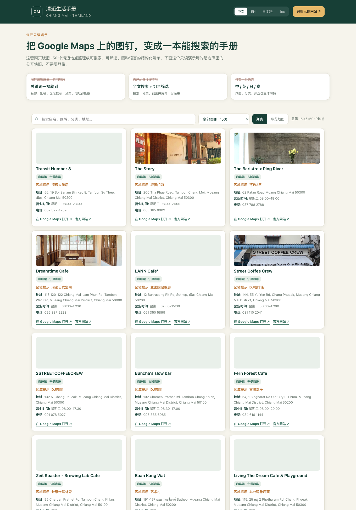
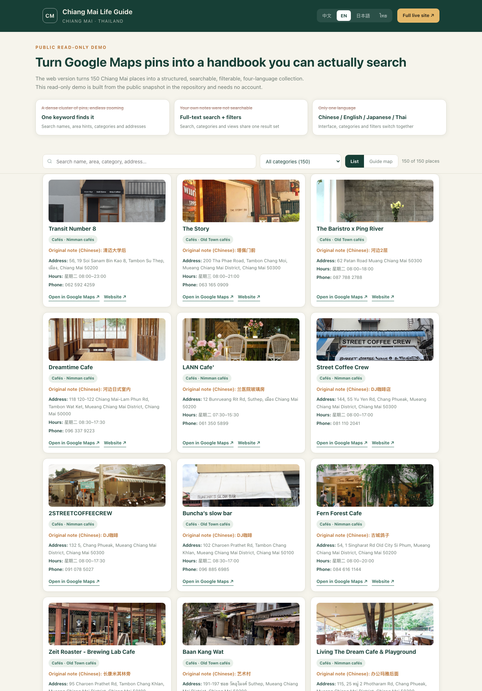
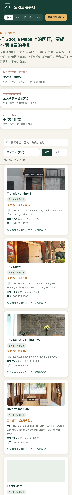
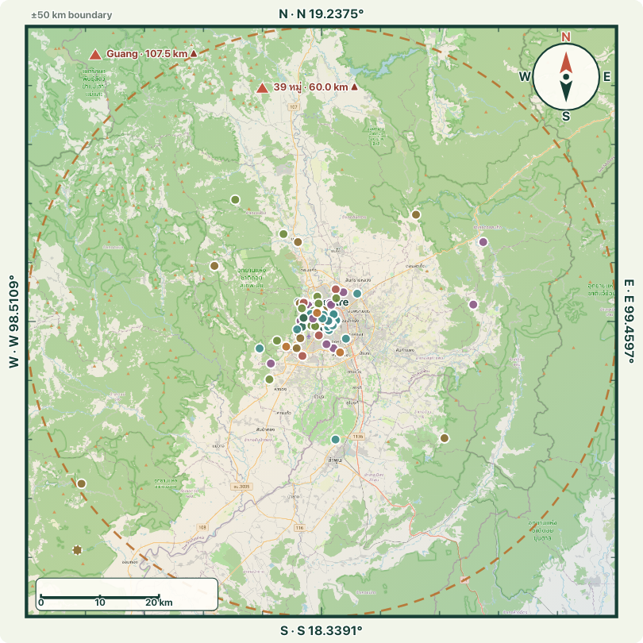
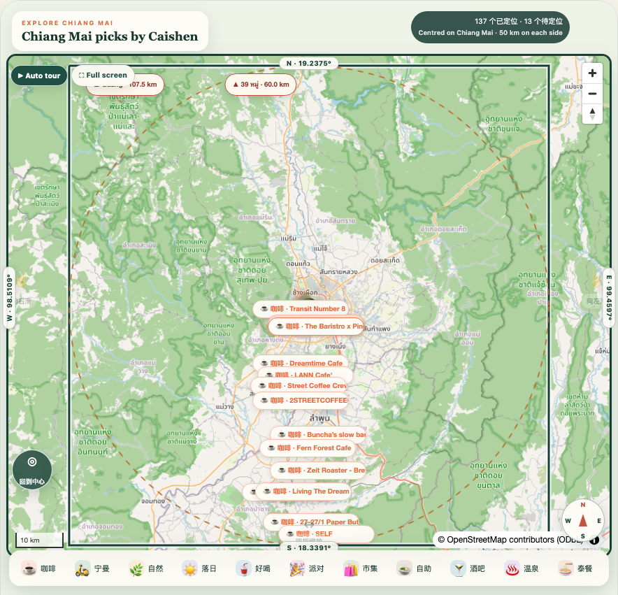
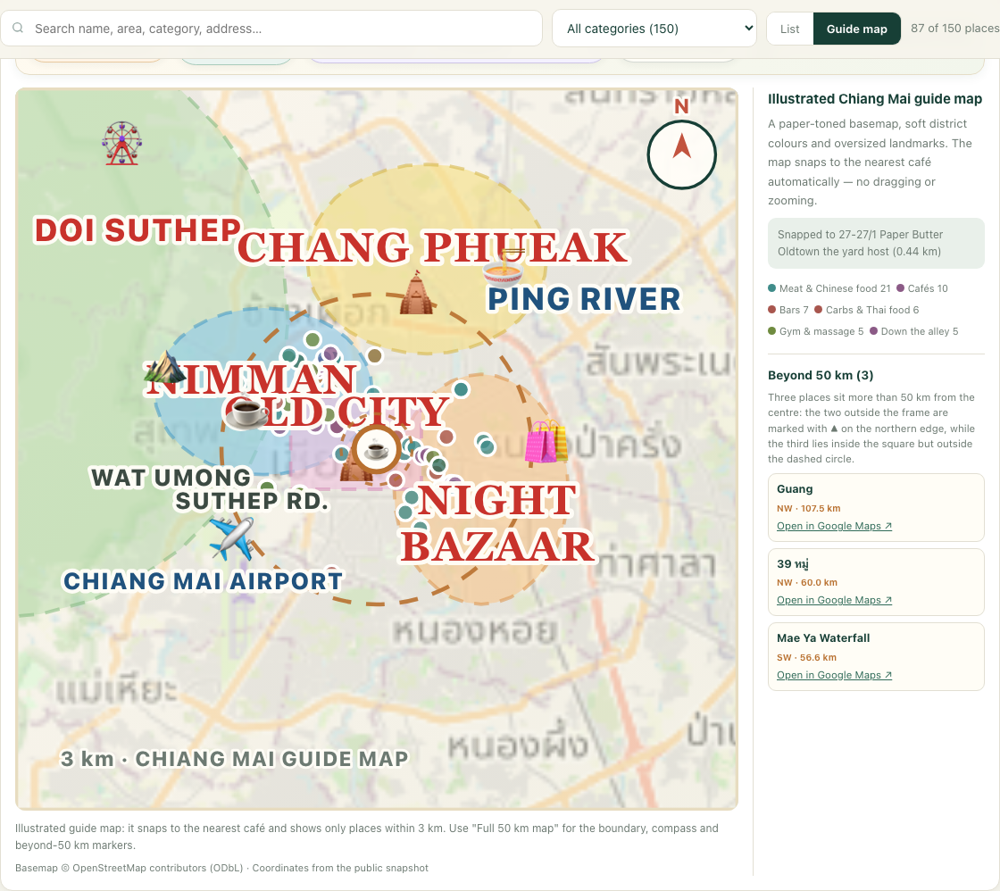
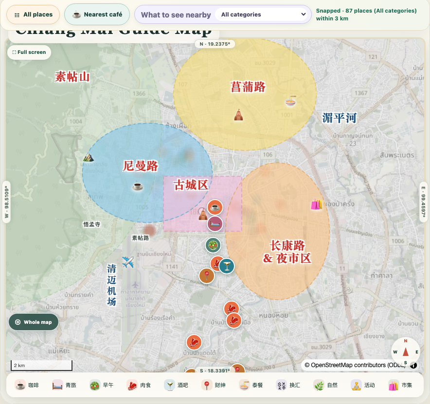

<div align="center">
  
  <h1>Manual · Chiang Mai Life Guide</h1>
  <p><strong>Turning 150 saved Google Maps pins into a searchable, multilingual, mobile-first web handbook.</strong></p>
  <p>
    <a href="https://cm.caishen.today"><strong>Live example site</strong></a> ·
    <a href="https://zixiang2008.github.io/favoriteManual/demo/"><strong>Public read-only demo</strong></a>
  </p>
  <p>
    <a href="README.md">English</a> ·
    <a href="docs/README.zh-CN.md">简体中文</a> ·
    <a href="docs/README.ja.md">日本語</a> ·
    <a href="docs/README.th.md">ไทย</a>
  </p>
</div>

---

## Contents

1. [What this is](#what-this-is)
2. [Where it came from](#where-it-came-from)
3. [The problems it solves](#the-problems-it-solves)
4. [How the web version solves them](#how-the-web-version-solves-them)
5. [Web version vs. the old Google Maps pins](#web-version-vs-the-old-google-maps-pins)
6. [Concrete advantages over Google Maps](#concrete-advantages-over-google-maps)
7. [Additional value](#additional-value)
8. [Live examples](#live-examples)
9. [Feature list](#feature-list)
10. [Architecture](#architecture)
11. [Quick start and configuration](#quick-start-and-configuration)
12. [Security and privacy](#security-and-privacy)
13. [Use cases and extensibility](#use-cases-and-extensibility)
14. [Responsible use](#responsible-use)

---

## What this is

Manual (Chiang Mai Life Guide) is a **mobile-first Progressive Web App** for a privately curated collection of places in Chiang Mai — cafés, restaurants, markets, hot springs, gyms, bars, event venues, currency exchanges, motorcycle repair shops, emergency contacts and more.

It replaces the old workflow of "drop a pin in Google Maps + write a note in Notion" with a standalone website:

- 150 places in 26 categories, searchable and filterable in the browser;
- instant switching between Chinese, English, Japanese and Thai;
- a list view and an interactive Chiang Mai flat-map view;
- category filters and nearby ranges from 200 m to 10 km;
- Google Maps enrichment merged into each place card (address, opening hours, phone, website, photos);
- community submissions, star ratings and shared editing by administrators and co-administrators;
- private access via a 4-digit PIN and limited-use invitation codes — **no credentials are included in this repository or the demo**.

**Live example: <https://cm.caishen.today>** (requires an account).
**Public read-only demo: <https://zixiang2008.github.io/favoriteManual/demo/>** (no account; try search, filters and the four languages).

---

## Where it came from

The original list worked like this:

1. Star or pin places in Google Maps — places to try, places visited, places worth returning to.
2. Keep a parallel Notion notebook with the notes that only make sense to the author: "closes at 11 pm", "behind Chiang Mai University", "there is a train carriage in the garden", "good for sunsets".
3. Paste a `maps.app.goo.gl` short link into each note so the notebook can jump back to the map.

So **the places lived in the map, the explanations lived in the notebook, and a short link was the only thing holding them together**. Once the collection grew past a hundred pins, that approach broke down.

---

## The problems it solves

### 3.1 Saved pins in Google Maps are tedious to look through and hard to read at a glance

- Opening the map shows a dense cluster of pins. Finding "that café by the river" means zooming, panning and tapping pins one by one, recognising them from memory.
- There is no overview: you cannot see **how many places you have, what categories they fall into, how many are in each category, or which neighbourhoods they cluster in**. A large collection reads as scattered dots rather than a handbook.
- A pin only says *where*. It does not say *why you saved it*. Notes, area hints and sub-categories are elsewhere, in another app.
- Saved lists follow the platform's ordering, not your own logic. Browsing by your own ideas — "sunset spots", "within an hour's drive", "around Nimman" — is not possible.

### 3.2 No search over your own collection

- Google Maps can of course search the whole world, but it **cannot search the things you wrote about your own saved places**: custom notes, area hints, tags, sub-categories, original notebook titles.
- The result is the familiar "I know I wrote this down, but I cannot find it again" — scrolling through pins, or running a separate search in Notion and then jumping back to the map.
- There is no combined "category + keyword + distance" filtering, and no way to ask "which cafés are within 500 m of me right now".

### 3.3 One language, while the audience needs four

- The interface follows the phone's system language, place names are often Thai or English, and **all personal notes and categories were in Chinese** — three languages mixed inside one list, with no consistent presentation.
- Chiang Mai friends, residents and visitors come from Chinese, English, Japanese and Thai contexts. Handing a Chinese-annotated list to a Japanese or Thai friend makes it unusable.
- Category names such as "hidden gems", "down the alley" or "one-hour trips" are highly personal Chinese labels; they cannot be switched to the reader's language, and there is no per-item translation.
- What was missing is not a translation of a single place name, but **a handbook whose entire presentation can switch language**.

### 3.4 Notes and maps are split, and upkeep keeps growing

- Every place has to be maintained twice: the pin in the map and the text in the notebook. Rename a shop or update its hours and you edit both. A dead short link is hard to notice.
- Short links age badly; during this project's cleanup, some entries had no map link at all and others no longer resolved to a single place, so each had to be corrected by hand.
- Nothing is structured: address, phone, hours and photos were typed by hand and verified across several apps.

### 3.5 Sharing and joint upkeep are limited

- A Google Maps list can be shared, but mostly as "other people can see the pins". Friends cannot easily add places, correct details or attach photos, and there is no record of who contributed what.
- With several people editing, the notebook and the map drift apart; there is no protection against overwrites and no audit trail.

### 3.6 No handbook experience on a phone

- A maps app is built for navigation, not for browsing your own collection: no home-screen install, no offline reading, no card layout designed for a phone, and a poor experience on weak networks.
- Answering a simple daily question — "where should we go today?" — takes far too many steps.

### 3.7 The data is not yours

- The collection's structure belongs to the platform. UI changes, list redesigns, account or regional restrictions can make years of saved pins hard to export or reuse.
- Private notes should not be entirely public either, but the platform offers little in the way of small-group, revocable, auditable access control.

---

## How the web version solves them

The idea is not "build another map", but **turn a collection into structured, searchable data, then present it as a website**:

| Step | What happens |
|---|---|
| Collect | Notion remains the single intake tool, preserving the habit of writing free-form notes |
| Structure | A scheduled one-way sync splits notes into fields: name, area hint, category, sub-category, tags, coordinates, map links |
| Enrich | A Google Maps cache adds address, phone, opening hours, website, photos and a canonical place link |
| Present | A Node.js service merges data at request time and serves a mobile PWA with search, filters, list/flat-map views and four languages |
| Co-maintain | Signed-in users submit places and award stars; administrators edit the display layer, and all community state is stored separately so sync never erases it |

Key design decision: **the website never writes back to Notion**. Notion is the archive, `runtime/` is the community state layer, and administrator edits only affect display — so the next sync cannot wipe out everyone's contributions.

---

## Web version vs. the old Google Maps pins

| Dimension | Before: Google Maps pins + notebook | Now: the web handbook |
|---|---|---|
| Finding one place | Zoom, pan, tap pins one by one, recognise from memory | Type a keyword; instant match on name, alias, area hint, category, tag, note and address |
| Overview | A cloud of dots with no visible structure | "150 places / 26 categories" up front, category chips and readable cards |
| Search | Searches the platform's places, not your own notes and labels | Full-text search plus category, distance and keyword combinations |
| Languages | Interface follows the system; notes and categories in one language only | Chinese / English / Japanese / Thai UI, mapped categories and labels, one-tap switching |
| Information density | A pin shows location; the explanation is in another app | One card carries notes, category, address, hours, phone, photos and map link |
| Views | Map only | List plus an interactive Chiang Mai flat map with a 50 km boundary, switchable without losing filters |
| Nearby | Estimated by eye | Explicit 200 m to 10 km ranges |
| Joint upkeep | Shared list is essentially read-only | Submissions, stars, co-admins, online editing, audit trail |
| Mobile | Navigation app, no offline mode, no home-screen icon | Installable PWA, Service Worker caching, mobile-first layout |
| Data ownership | Platform-defined structure, hard to export | Own `data/` snapshots plus reproducible build scripts, portable and backup-friendly |
| Access control | Public or shared link | PIN login, limited-use revocable codes, signed sessions, rate limits, audit |
| Dependency | Fully tied to the platform | Self-held data; Google Maps is enrichment, not the only front door |

---

## Concrete advantages over Google Maps

1. **From hunting pins to searching content.** Search covers everything you wrote yourself, not just place names indexed by a platform. Saved knowledge becomes findable again.
2. **From scattered dots to a handbook with a table of contents.** Categories, tags, area hints and sub-types form a directory; you browse by intent and then decide where to go.
3. **Four languages that actually work.** Not just translated menu items — the interface, categories, filters and hints switch together, so the same dataset can be handed to readers in different languages.
4. **Information in one place.** Address, hours, phone, website, photos and map link are merged into a single card instead of scattered across map, notebook and search results.
5. **Two complementary views.** A list for browsing the handbook, a map for understanding spatial distribution, both driven by the same filter state.
6. **Distance is a filter, not a guess.** 200 m to 10 km answers "what is near me now", not merely "what exists on the map".
7. **Built around your own use cases.** You define the taxonomy, note format and display names, unconstrained by the platform's preset list types.
8. **Co-maintained and traceable.** Friend submissions, star incentives, automatic co-admin promotion, display-layer corrections and an audit log — and sync never overwrites community contributions.
9. **Private but shareable.** PIN plus limited-use invitation codes control who gets in, which is far more suitable for a personal list than a public link.
10. **Mobile-first and offline-capable.** Installable PWA with cached static assets, so the handbook still opens on a weak connection.
11. **Data you own and can move.** Structured JSON plus sync and build scripts can be regenerated, exported and backed up at any time.
12. **Still just a web page.** One link, no app store, no installation, consistent across iPhone, Android and desktop.
13. **Real geography, not a globe.** A flat Chiang Mai map with a 50 km boundary, compass, scale bar and true coordinates shows where places actually are — something a globe of decorative clusters cannot do.
14. **A guide map you cannot get lost in.** The map snaps to the nearest café, draws soft district colours with oversized landmark lettering, and replaces free pan/zoom/rotate with four explicit controls — so the map never slides away under your thumb on a phone.

---

## Additional value

- **Keeps Google Maps' strengths and fixes only the gaps.** The project does not abandon Google Maps: address, hours, phone, website, photos and place links still come from a Google Maps cache, and each card links back for navigation. The website is a better organisation and retrieval layer, not a replacement.
- **Organise once, benefit continuously.** Notion stays a low-friction intake tool; the website handles structure. Sync is one-way, atomic and keeps the previous version on failure, so content updates cannot break the site.
- **Content quality is visible.** The enrichment pass labels entries that resolved to a real Google place and those whose links were unusable, so bad data does not silently enter the handbook.
- **A community that runs itself.** Five stars per new place and automatic co-admin status at 30 stars turn "who maintains this" into a mechanism rather than one person's job.
- **Reusable for any city or theme.** Data, taxonomy and language maps are configuration; swap `places.json` and this becomes a Bangkok guide, a Tokyo coffee list, a hiking route set or an internal team directory.
- **No ads, no third-party tracking.** Self-hosted service with no platform ads or recommendations inserted into the interface.
- **Lightweight deployment.** A single Node.js service, Docker and Cloudflare Tunnel; the origin listens only on loopback and never exposes a public port, with HTTPS handled at the edge.

---

## Live examples

| Purpose | URL | Notes |
|---|---|---|
| Full example site | **<https://cm.caishen.today>** | Production version with login, submissions, the illustrated Chiang Mai guide map, snap-to-nearest-café and nearby filters; requires an account |
| Legacy URL | <https://cm.caishen2049.us> | Same application and data, kept for links shared earlier |
| Public read-only demo | <https://zixiang2008.github.io/favoriteManual/demo/> | No account needed; try full-text search, category filters, four-language switching, place cards and the illustrated guide map, built from the public snapshot in this repository |

**Interface preview** (public read-only demo):

<p>


</p>
<p></p>

> Place photos in the screenshots come from the public Google Maps cache and are shown for interface demonstration only.

The demo is a static, read-only illustration of why the web version is easier to search and read. It renders the same illustrated guide map as an SVG, including the snap-to-nearest-café focus and the four guide controls; login, submissions, distance filters and the MapLibre GL version live in the full example site. **For privacy, neither the repository nor the demo contains any PIN, invitation code or login credential.**

Demo data can be regenerated with `node scripts/build-demo-data.mjs` from `data/places.json` and `data/google-maps-cache.json`.

### The Chiang Mai flat map (50 km boundary)

The map view has been switched from a spherical globe to a **flat, north-up map of Chiang Mai**. Every saved place is now drawn at its real coordinates, so "inside the old town / out towards Mae Rim / far to the north" is obvious at a glance instead of being guessed from a cluster of pins on a globe.

<p></p>

| Design decision | What it means |
| --- | --- |
| Base map | Multi-colour OpenStreetMap raster tiles (roads, the Ping River, Doi Suthep, green areas and highways are easy to tell apart), plus a locally stitched zoom-11 mosaic used as a fallback when tiles are slow or unavailable |
| Centre and edges | Centred on the old town at `98.9853°E, 18.7883°N`; the north, south, west and east edges are each 50 km away, forming a 100 x 100 km square |
| Edge coordinates | North `19.2375°`, south `18.3391°`, west `98.5109°`, east `99.4597°`, printed on the four sides |
| Orientation and scale | A compass marks N / E / S / W and a metric scale bar shows kilometres; direction labels switch with the UI language |
| Place markers | All 137 places with coordinates are projected from their **real latitude and longitude** into category-coloured dots or labels; the decorative cluster offsets of the old globe view are gone |
| 50 km reference circle | A dashed circle shows "50 km from the centre", making it clear when a place is inside the square but outside the radius |
| Places beyond 50 km | 3 of the 150 places are more than 50 km from the centre: `Guang` (107.5 km), `39 หมู่` (60.0 km) and `Mae Ya Waterfall` (56.6 km). The 2 that fall outside the square are marked with `▲` on the north edge with their distance; the third sits inside the square but outside the dashed circle. Nothing is lost, and the 50 km limit stays intact |
| Search linkage | Search, category filters and the map share one result set; filtering redraws only the matching places |

The production site (after login) uses a MapLibre GL flat map, while the public demo renders the same boundaries as a static SVG:

<p></p>

`scripts/build-flat-map.mjs` generates `public/flat-map-config.js` and `demo/flat-map-config.js` from the same centre, bounds, directions and basemap parameters. Run `npm run map:config` to regenerate both, so the two views can never drift apart.

### The illustrated guide map: no more panning around

The flat map fixed the geography, but it still expected people to drag, pinch and zoom to find things. On a phone that means the map keeps "running away" under your thumb. The map view now behaves like a printed travel-guide spread instead.

<p></p>

| Behaviour | What changed |
| --- | --- |
| Visual style | Paper-toned basemap, soft translucent district blobs (Nimman, Chang Phueak, the old city, Night Bazaar, the mountain side), oversized landmark lettering with a white halo and pictogram decorations — modelled on a printed Chiang Mai tourist map |
| No free roaming | Drag, scroll zoom, rotate, double-click zoom, box zoom and keyboard panning are all disabled. The camera only moves through the explicit controls below, so the map never slides away while you read it |
| Snap to the nearest café | On load the map finds the café closest to you (or to the city centre when location is unavailable), centres it and zooms to old-town level |
| `Back to all places` | Clears the snap and every filter, then returns to the full list |
| `Nearest café` | Re-snaps to the closest café at any time |
| `What to see nearby` | A category selector scoped to the 3 km around the snapped point, plus "All categories" |
| `Whole map` | Returns to the 50 km boundary view with compass, scale bar and the beyond-50 km markers |
| Illustration visibility | The illustrated layer appears at old-town zoom and is hidden at the 50 km overview, so district lettering never piles up into an unreadable cluster |

The production site after login uses the same behaviour with MapLibre GL:

<p></p>

`scripts/build-guide-config.mjs` generates `public/guide-config.js` and `demo/guide-config.js` from one source of truth (district blobs as GeoJSON, landmark labels in four languages, pictograms and snap parameters). Run `npm run guide:config` to regenerate both, so the demo and the live site can never drift apart.

---

## Feature list

- Chinese, English, Japanese and Thai mobile PWA
- Full-text search; category, sub-category, tag and 200 m–10 km distance filters
- List view and an illustrated Chiang Mai guide map (MapLibre + OpenStreetMap raster tiles with a stitched local mosaic fallback), locked to four explicit controls instead of free pan/zoom, snapping to the nearest café on load
- 150-place snapshot across 26 categories; address, hours, phone, website, booking, photos and map links
- Named users, 4-digit PIN, salted scrypt hashes, signed sessions, login rate limits, audit logs
- Limited-use, revocable invitation codes
- Scheduled one-way Notion sync with atomic replacement and failure recovery
- Community submissions with optional attribution and client-side photo compression
- Five stars per new place, automatic co-administrator status at 30 stars
- Administrator and co-administrator editing via a durable display override layer
- Docker deployment behind Cloudflare Tunnel without exposing the origin

---

## Architecture

```text
Notion workspace (intake)
  | scheduled one-way sync, atomic replacement
  v
data/places.json + Google Maps cache (publishable snapshots)
  | merged at request time
  v
Node.js service
  + users, invitations, sessions, audit
  + community contributions and media
  + administrator display overrides (runtime/)
  v
Mobile PWA: search / categories / distance / list / flat map / 4 languages
  v
Cloudflare Tunnel + HTTPS
```

`runtime/` holds users, submissions, photos, display overrides and audit records independently of the sync pipeline, so a Notion sync cannot delete community content. Administrator edits affect the display layer only and never rewrite original Notion records.

---

## Quick start and configuration

Requires Node.js 22 or newer.

```bash
cp .env.example .env
npm install
npm start
```

Open `http://127.0.0.1:3000`. Generate a PIN hash with `npm run hash-pin -- 1234` and put only the hash into `PIN_USERS_JSON`.

| Variable | Purpose |
|---|---|
| `SESSION_SECRET` | Session signing and invitation-code encryption |
| `PIN_USERS_JSON` | Initial accounts, hashes only |
| `NOTION_TOKEN` | Read access to the shared Notion source |
| `SYNC_INTERVAL_MINUTES` | One-way sync interval |
| `GOOGLE_MAPS_API_KEY` | Optional live Google Places fallback |
| `RUNTIME_DIR` | Persistent users, edits, media and audit data |

Sync, tests and containers:

```bash
NOTION_TOKEN=your_token npm run sync:notion
npm test
docker compose up -d --build
curl http://127.0.0.1:3010/healthz
```

Mount `runtime/` persistently and use HTTPS in production (production session cookies are secure-only).

Layout: `public/` frontend and localization · `server.mjs` auth and APIs · `scripts/` sync and data builders · `data/` publishable snapshots · `demo/` static read-only demo · `test/` integration tests · `ops/` deployment and checks.

---

## Security and privacy

- Salted scrypt PIN hashes only; no plain-text PIN is ever stored
- Exponential rate limiting on failed logins
- HttpOnly, SameSite, signed cookies
- Origin validation for state-changing requests
- Audit records for registration, login, permissions, codes and content edits
- `runtime/`, `.env`, tunnel credentials and operational runbooks are excluded by `.gitignore`

---

## Use cases and extensibility

Fits any situation with "a batch of places + a pile of personal notes + repeated lookup": city life guides, relocation checklists, café and restaurant collections, hiking or cycling routes, site inspections, team resource directories and event venue lists.

Extending it is straightforward: replace the data source, adjust the taxonomy and language dictionaries, add fields or views as needed. Because the display layer is separate from the archive, changing the interface never pollutes the original data. If private access is unnecessary, the static demo form can be published on its own as a plain static site.

---

## Responsible use

Before reuse, review the current terms and licenses of Notion, Google Maps, third-party photos and imported content. Publish only media and text you have permission to use. The example site requires an account; please do not attempt to guess or request credentials.
