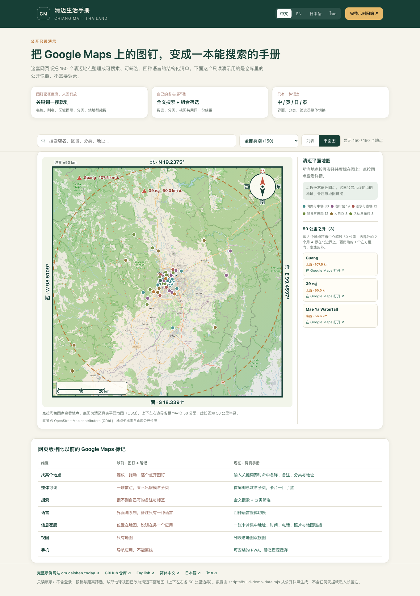
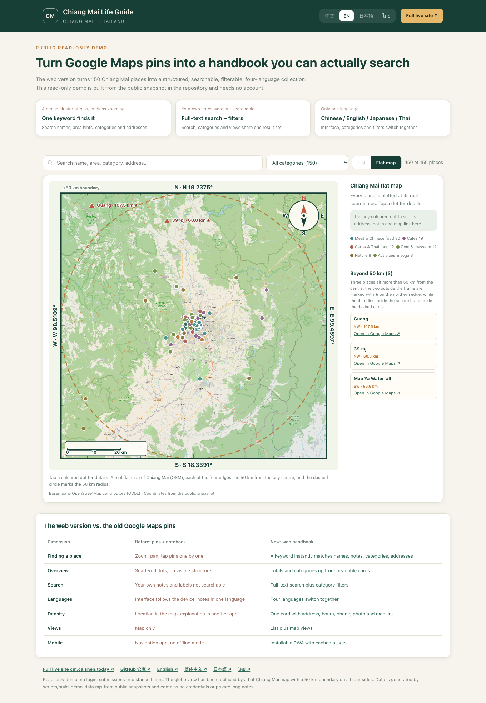
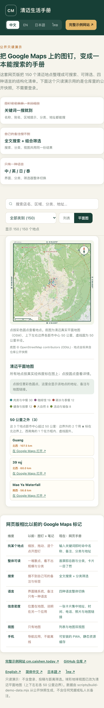
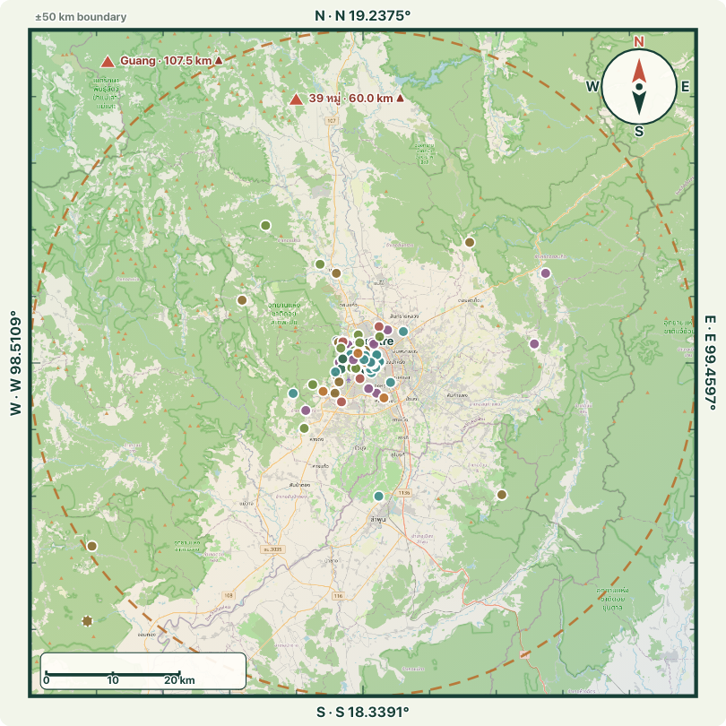
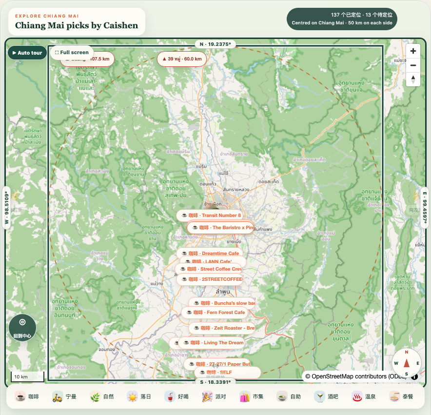

# Manual ・チェンマイ生活ガイド（清迈生活手册）

[English](../README.md) · [简体中文](README.zh-CN.md) · [日本語](README.ja.md) · [ไทย](README.th.md) · [サンプルサイト](https://cm.caishen.today) · [公開デモ](https://zixiang2008.github.io/favoriteManual/demo/)

> 一言でいうと：Google Maps のピンとメモ帳に散らばっていた 150 件のチェンマイのスポットを、**検索でき、絞り込みができ、4 言語に対応し、スマホ優先**のプライベートな場所ハンドブックに変えたプロジェクトです。

---

## 目次

1. [これは何か](#1-これは何か)
2. [原点：以前のやり方](#2-原点以前のやり方)
3. [解決したい課題](#3-解決したい課題)
4. [ウェブ版による解決](#4-ウェブ版による解決)
5. [ウェブ版 対 以前の Google Maps ピン](#5-ウェブ版-対-以前の-google-maps-ピン)
6. [Google Maps と比べた具体的な利点](#6-google-maps-と比べた具体的な利点)
7. [さらに得られる価値](#7-さらに得られる価値)
8. [オンラインサンプル](#8-オンラインサンプル)
9. [機能一覧](#9-機能一覧)
10. [アーキテクチャ](#10-アーキテクチャ)
11. [導入と設定](#11-導入と設定)
12. [セキュリティとプライバシー](#12-セキュリティとプライバシー)
13. [想定用途と拡張性](#13-想定用途と拡張性)
14. [利用にあたっての注意](#14-利用にあたっての注意)

---

## 1. これは何か

Manual（チェンマイ生活ガイド / 清迈生活手册）は、チェンマイで個人的に集めたスポット——カフェ、レストラン、マーケット、温泉、ジム、バー、イベント会場、両替所、バイク修理店、緊急連絡先など——を管理する**スマホ優先の PWA（プログレッシブウェブアプリ）**です。

「Google Maps にピンを立てる ＋ Notion にメモを書く」という従来の運用を、独立したウェブサイトに置き換えました。

- 150 件・26 カテゴリのスポットを、ブラウザ上で直接検索・絞り込み・閲覧
- 中国語・英語・日本語・タイ語の 4 言語をワンタップで切り替え
- リスト表示とチェンマイ平面地図の 2 つのビュー（四辺それぞれ市中心から 50 km、東西南北の方位付き）
- カテゴリ絞り込みと、200 m〜10 km の「近く」絞り込み
- Google Maps の住所・営業時間・電話・公式サイト・写真を各スポットカードに統合
- 友人による新規スポット投稿・スター評価、管理者と共同管理者によるオンライン編集
- 4 桁 PIN と回数制限付き招待コードによる非公開アクセス。**リポジトリにもデモにも認証情報は一切含まれていません**

**サンプルサイト：<https://cm.caishen.today>**（アカウント必要）。
**公開読み取り専用デモ：<https://zixiang2008.github.io/favoriteManual/demo/>**（アカウント不要。検索・カテゴリ絞り込み・4 言語切替を体験できます）。

---

## 2. 原点：以前のやり方

元のリストはこう運用されていました。

1. Google Maps で「行きたい」「行った」「また行きたい」場所に星やピンを付ける。
2. 同時に Notion で、「23 時に閉まる」「チェンマイ大学の裏」「庭に鉄道の客車がある」「夕日がきれい」といった、自分にしか分からないメモを残す。
3. 各メモに `maps.app.goo.gl` の短縮リンクを貼り、ノートから地図へ戻れるようにする。

つまり**「場所は地図の中、説明はノートの中、その間をつなぐのは短縮リンクだけ」**という状態でした。ピンが 100 件を超えたあたりで、この方法は破綻します。

---

## 3. 解決したい課題

### 3.1 Google Maps のピンは探すのが非常に面倒で、直感的ではない

- 地図を開くとピンがびっしり並んでいる。「この前の川沿いのカフェ」を探すには、拡大・縮小・スクロールを繰り返し、ピンを一つずつタップして記憶を頼りに判別するしかありません。
- 全体像がありません。**全部で何件あるか、どんなカテゴリに分かれるか、各カテゴリに何件あるか、どのエリアに集中しているか**がひと目で分かりません。数が増えるほど、ハンドブックではなく「散らばった点」に見えてきます。
- ピンは「どこにあるか」しか示しません。「なぜ保存したか」は別アプリのメモにあり、地図を見ただけでは分かりません。
- 保存リストの並びはプラットフォーム次第で、自分の使い方に沿いません。「夕日スポット」「車で 1 時間圏」「ニマン周辺」といった自分専用の分類で眺めることができません。

### 3.2 検索機能がない

- Google Maps は世界中の場所を検索できますが、**自分が保存した場所について自分で書いた内容**——独自のメモ、エリアのヒント、タグ、細分類、元ノートのタイトル——は検索対象になりません。
- 結果として「確かに書いたはずなのに見つからない」が起こります。ピンや長いリストを目で追うか、Notion で別途検索してから地図に戻るしかありません。
- 「カテゴリ ＋ キーワード ＋ 距離」の組み合わせ絞り込みもなく、「今から 500 m 以内にカフェはどこか」という問いに答えられません。

### 3.3 言語が 1 つしかなく、多言語の需要に応えられない

- 画面の言語は端末設定に従い、スポット名はタイ語や英語、そして**自分で書いたメモとカテゴリは中国語だけ**。1 つのリストに 3 つの言語が混在し、統一された提示がありません。
- チェンマイの友人・滞在者・訪問者は中国語・英語・日本語・タイ語の 4 つの言語圏から来ます。中国語のメモ付きリストを日本やタイの友人に渡しても、実質使えません。
- 「掘り出し物」「路地裏」「1 時間圏」のようなカテゴリ名は極めて個人的な中国語表現で、読者の言語に切り替えることも、項目ごとに翻訳することもできません。
- 不足していたのは「地名を 1 件翻訳する機能」ではなく、**ハンドブック全体を読者の言語で提示し直す仕組み**でした。

### 3.4 メモと地図が分断され、維持コストが増え続ける

- 1 件につき「地図のピン」と「ノートの文章」の 2 か所を管理します。店名や営業時間が変われば両方を直し、短縮リンクが切れても気付きにくい。
- 短縮リンクは時間が経つと行き先が判別できなくなります。実際、このプロジェクトの整理時には「元々地図リンクがない」項目や「リンクが単一の場所を指さなくなった」項目があり、1 件ずつ校正が必要でした。
- 住所・電話・営業時間・写真が構造化されておらず、確認するたびに複数のアプリを行き来していました。

### 3.5 共有と共同保守が限られている

- Google Maps のリストは共有できますが、基本的に「他人がピンを見られる」までです。友人が新しい場所を追加したり、情報を修正したり、写真を添付したりしづらく、「誰が何を貢献したか」の記録や動機付けもありません。
- 複数人が同時に編集するとノートと地図が食い違い、上書きを防ぐ仕組みも操作履歴もありません。

### 3.6 スマホに「ハンドブック」としての体験がない

- 地図アプリはナビゲーション用であり、自分のコレクションを眺めるためのものではありません。ホーム画面に追加できず、オフラインで読めず、スマホで読むためのカードレイアウトもなく、電波が弱いとさらに使いにくくなります。
- 「今日どこへ行こう」という日常的な問いに答えるまでの操作が長すぎます。

### 3.7 データが自分の手元にない

- コレクションの構造はプラットフォームが決めます。UI の刷新、リスト仕様の変更、アカウントや地域の制限によって、長年溜めたピンを書き出したり再利用したりしづらくなる恐れがあります。
- 個人的なメモを全面的に公開したくはありませんが、「小範囲・取り消し可能・監査可能」なアクセス制御も用意されていません。

---

## 4. ウェブ版による解決

発想は「もう一つ地図を作る」ことではなく、**コレクションを構造化された検索可能なデータにして、ウェブで提示する**ことです。

| 段階 | 内容 |
|---|---|
| 収集 | Notion を唯一の入力窓口として残し、自由形式のメモ習慣を維持 |
| 構造化 | 定期の一方同期でメモを項目に分解：名称、エリアヒント、カテゴリ、細分類、タグ、座標、地図リンク |
| 補完 | Google Maps キャッシュから住所、電話、営業時間、公式サイト、写真、正規の場所リンクを付与 |
| 提示 | Node.js がリクエスト時に統合し、検索・絞り込み・リスト／平面地図表示・4 言語を備えたスマホ PWA を配信 |
| 共同保守 | ログイン後に投稿・スター付与、管理者が表示層を編集。コミュニティの状態は別保存で、同期に消されない |

重要な設計判断：**ウェブサイトは Notion に書き戻しません**。Notion は原本アーカイブ、`runtime/` はコミュニティの状態層、管理者の修正は表示層だけに効くため、次の同期で皆の貢献が消えることはありません。

---

## 5. ウェブ版 対 以前の Google Maps ピン

| 観点 | 以前：Google Maps のピン ＋ ノート | 現在：ウェブ版ハンドブック |
|---|---|---|
| 1 件を探す | 拡大・移動・ピンを順に開き、記憶で判別 | キーワード入力で即時絞り込み。名称、別名、エリアヒント、カテゴリ、タグ、メモ、住所に一致 |
| 全体の把握 | 点の集まりで、規模も構造も見えない | 冒頭に「150 件 / 26 カテゴリ」。カテゴリチップとカードで一目瞭然 |
| 検索 | プラットフォームの場所のみ。自分のメモや独自ラベルは対象外 | 全文検索 ＋ カテゴリ・距離・キーワードの組み合わせ |
| 言語 | 画面は端末依存、メモとカテゴリは 1 言語のみ | 中・英・日・タイの 4 言語 UI、カテゴリとラベルの言語対応、ワンタップ切替 |
| 情報密度 | ピンは位置だけ。説明は別アプリ | 1 枚のカードにメモ、カテゴリ、住所、営業時間、電話、写真、地図リンク |
| ビュー | 地図のみ | リスト ＋ インタラクティブなチェンマイ平面地図（50 km の境界）。絞り込み状態を保ったまま切替 |
| 近く | 目測 | 200 m〜10 km の距離帯で明示的に絞り込み |
| 共同保守 | 共有リストは実質読み取り専用 | 投稿、スター、共同管理者、オンライン編集、監査履歴 |
| モバイル | ナビアプリ。オフライン不可、ホーム画面アイコンなし | インストール可能な PWA、Service Worker キャッシュ、スマホ優先レイアウト |
| データの所有 | プラットフォーム構造で导出が困難 | 自前の `data/` スナップショット ＋ 再現可能なビルドスクリプト。移行・バックアップ自由 |
| アクセス制御 | 公開またはリンク共有 | PIN ログイン、回数制限付き招待コード、署名セッション、レート制限、監査 |
| 依存関係 | 完全にプラットフォーム依存 | データは自前。Google Maps は情報補強であり唯一の入口ではない |

---

## 6. Google Maps と比べた具体的な利点

1. **「ピンを探す」から「内容を検索する」へ。** 自分が書いた文字列まですべて検索対象になり、記録した知識を取り戻せます。最も直接的な改善です。
2. **「散らばった点」から「目次付きのハンドブック」へ。** カテゴリ、タグ、エリアヒント、細分類が目次になり、目的から眺めて行き先を決められます。
3. **実用的な 4 言語対応。** メニューの翻訳だけでなく、画面・カテゴリ・絞り込み・ヒントがまとめて切り替わり、同じデータを別言語の読者に渡せます。
4. **情報が 1 か所に集約。** 住所、営業時間、電話、公式サイト、写真、地図リンクが 1 枚のカードにまとまり、地図・ノート・検索結果の行き来が不要になります。
5. **補い合う 2 つのビュー。** リストは「ハンドブックをめくる」用途、地図は「空間的な分布を見る」用途。同じ絞り込み結果のまま切り替えられます。
6. **距離が推測ではなく絞り込み条件に。** 200 m〜10 km で「今の近くに何があるか」に答えます。
7. **自分の使い方に合わせて設計できる。** 分類体系、メモの書式、表示名を自分で決められ、プラットフォームの定型リストに縛られません。
8. **共同保守と追跡が可能。** 友人の投稿、スターによる動機付け、30 スターでの共同管理者昇格、表示層の修正、監査履歴。しかも同期がコミュニティの貢献を上書きしません。
9. **非公開だが共有できる。** PIN と回数制限付き招待コードで参加者を制御でき、公開リンクより個人的なリストに適しています。
10. **スマホ優先・オフライン対応。** ホーム画面にインストールでき、静的リソースをキャッシュするため電波が弱くても閲覧できます。
11. **データは自分のもの、移行も自由。** 構造化 JSON と同期・ビルドスクリプトで、いつでも再生成・エクスポート・バックアップが可能です。
12. **それでもただのウェブページ。** リンク 1 つで開け、アプリのインストールやストアは不要。iPhone・Android・デスクトップで同じ体験です。
13. **球形の模式図ではなく実際の地理。** チェンマイ平面地図に 50 km の境界・方位・縮尺・実座標を重ね、各スポットの位置をひと目で示します。装飾的に集約していた地球儀表示ではできなかったことです。

---

## 7. さらに得られる価値

- **Google Maps の長所は残し、足りない部分だけを補う。** 住所・営業時間・電話・公式サイト・写真・場所リンクは引き続き Google Maps キャッシュから取得し、各カードから地図へ飛んでナビゲーションできます。ウェブ版は代替ではなく「より使いやすい整理・検索のレイヤー」です。
- **一度整理すれば長く効く。** Notion は負担の少ない入力窓口のまま、ウェブが構造化を担当。同期は一方通行・原子的置換・失敗時は前版を保持するため、更新でサイトが壊れません。
- **コンテンツの品質が可視化される。** 取得処理で「実際の Google の場所に解決できた」項目と「リンクが使えない」項目を明示し、壊れたデータが黙って混入しません。
- **コミュニティが自走する。** 新規 1 件につき 5 スター、累計 30 スターで共同管理者へ自動昇格。「誰が保守するか」を個人の頑張りではなく仕組みにできます。
- **どの都市・テーマにも転用可能。** データ、分類、言語辞書は設定です。`places.json` を差し替えればバンコクのガイド、東京のカフェリスト、ハイキングルート集、チームの社内リポジトリになります。
- **広告なし、第三者トラッキングなし。** 自前ホスティングで、プラットフォーム広告やおすすめが画面に挿入されません。
- **軽量な運用。** Node.js 単一サービス ＋ Docker ＋ Cloudflare Tunnel。オリジンはループバックのみで待ち受け、公開ポートを晒さず、HTTPS はエッジが担当します。

---

## 8. オンラインサンプル

| 用途 | URL | 備考 |
|---|---|---|
| 完全なサンプルサイト | **<https://cm.caishen.today>** | 本番版。ログイン、投稿、チェンマイ平面地図、近く絞り込みを搭載。アカウント必要 |
| 旧 URL | <https://cm.caishen2049.us> | 同じアプリ・同じデータ。初期に共有したリンクのために維持 |
| 公開読み取り専用デモ | <https://zixiang2008.github.io/favoriteManual/demo/> | アカウント不要。全文検索、カテゴリ絞り込み、4 言語切替、スポットカードを体験。本リポジトリの公開スナップショットから生成 |

**画面プレビュー**（公開読み取り専用デモ）：

<p>


</p>
<p></p>

> スクリーンショット内の写真は公開済みの Google Maps キャッシュ由来で、画面説明のためだけに使用しています。

デモは「なぜウェブ版の方が探しやすく読みやすいか」を示す静的な読み取り専用版です。ログイン、投稿、距離絞り込み、インタラクティブなチェンマイ平面地図は完全版でご確認ください。**プライバシー保護のため、リポジトリにもデモにも PIN・招待コード・ログイン情報は含まれていません。**

デモ用データは `node scripts/build-demo-data.mjs` で `data/places.json` と `data/google-maps-cache.json` から再生成できます。

### 8.1 チェンマイ平面地図：50 km の境界と実座標

地図表示を球形の地球儀から**北を上にしたチェンマイ平面地図**へ変更しました。保存したスポットはすべて実際の緯度経度に描かれるため、「旧市街の中／メーリム方面／さらに北」がひと目で分かり、地球儀上に装飾的に集められた点から推測する必要がありません。

<p></p>

| 設計点 | 内容 |
| --- | --- |
| 背景地図 | 多色の OpenStreetMap タイル（道路、ピン川、ドイステープ、緑地、幹線道路を判別しやすい）。タイルが遅い・取得できない時はローカルで結合した zoom 11 画像を代わりに表示 |
| 中心と境界 | 旧市街の中心 `98.9853°E, 18.7883°N` を基準に、上下左右それぞれ 50 km。100 × 100 km の正方形になります |
| 四辺の座標 | 北 `19.2375°`、南 `18.3391°`、西 `98.5109°`、東 `99.4597°` を地図の四辺に表示 |
| 方位と縮尺 | コンパスで北・東・南・西を示し、キロメートル単位の縮尺を掲載。方位ラベルは UI の言語に合わせて切り替わります |
| スポット表示 | 座標を持つ 137 件を**実際の緯度経度**からカテゴリ色の円・ラベルへ投影。旧地球儀表示の装飾的な集約オフセットは廃止しました |
| 50 km の参照円 | 破線の円は「旧市街の中心から 50 km」を示し、枠内だが半径外にあるスポットを判別できます |
| 50 km 圏外 | 150 件のうち 3 件が旧市街の中心から 50 km 超です：`Guang`（107.5 km）、`39 หมู่`（60.0 km）、`Mae Ya Waterfall`（56.6 km）。実際に正方形の外にある 2 件は北の境界に `▲` と距離を添えて表示し、残る 1 件は枠内・破線円外です。情報を失わずに 50 km の上限を守ります |
| 検索との連動 | 検索・カテゴリ絞り込み・地図は同じ結果を共有し、絞り込むと該当スポットだけを描き直します |

本番サイト（ログイン後）は MapLibre GL の平面地図、公開デモは同じ境界設定から生成した SVG の静的な平面地図です：

<p></p>

中心・境界・方位・背景地図のパラメータは `scripts/build-flat-map.mjs` が一括計算し、`public/flat-map-config.js` と `demo/flat-map-config.js` に書き出します。`npm run map:config` で両方を再生成できるため、2 つの表示が食い違うことはありません。

---

## 9. 機能一覧

- 中国語・英語・日本語・タイ語の 4 言語モバイル PWA
- 全文検索、カテゴリ・細分類・タグ・200 m〜10 km の距離絞り込み
- リスト表示とチェンマイ平面地図（MapLibre ＋ OpenStreetMap カラータイル、ローカル結合画像を予備に使用）
- 150 件・26 カテゴリのスナップショット。住所、営業時間、電話、公式サイト、予約、写真、地図リンク
- 具名ユーザー、4 桁 PIN、salt 付き scrypt ハッシュ、署名セッション、ログイン制限、監査ログ
- 回数制限・無効化が可能な招待コード
- Notion からの定期一方同期、原子的置換、失敗時は前版を保持
- コミュニティ投稿、任意の投稿者名表示、クライアント側の画像圧縮
- 新規 1 件につき 5 スター、累計 30 スターで共同管理者に自動昇格
- 管理者・共同管理者による永続的な表示上書きレイヤーの編集
- Docker 配備 ＋ Cloudflare Tunnel、オリジンを公開しない構成

---

## 10. アーキテクチャ

```text
Notion ワークスペース（入力）
  | 定期の一方同期・原子的置換
  v
data/places.json + Google Maps キャッシュ（公開可能なスナップショット）
  | リクエスト時に統合
  v
Node.js サービス
  + ユーザー、招待コード、セッション、監査
  + コミュニティ投稿とメディア
  + 管理者の表示上書き（runtime/）
  v
モバイル PWA：検索 / カテゴリ / 距離 / リスト / 平面地図 / 4 言語
  v
Cloudflare Tunnel + HTTPS
```

`runtime/` はユーザー、投稿、写真、表示上書き、監査記録を同期フローから独立して保持するため、Notion 同期でコミュニティの内容が消えません。管理者の修正は表示層のみで、Notion の原本は書き換えません。

---

## 11. 導入と設定

Node.js 22 以降が必要です。

```bash
cp .env.example .env
npm install
npm start
```

`http://127.0.0.1:3000` を開きます。`npm run hash-pin -- 1234` で PIN ハッシュを生成し、`PIN_USERS_JSON` にはハッシュのみを設定してください。

| 変数 | 用途 |
|---|---|
| `SESSION_SECRET` | セッション署名と招待コードの暗号化 |
| `PIN_USERS_JSON` | 初期アカウント（ハッシュのみ） |
| `NOTION_TOKEN` | 共有 Notion ソースの読み取り |
| `SYNC_INTERVAL_MINUTES` | 一方同期の間隔 |
| `GOOGLE_MAPS_API_KEY` | 任意のリアルタイム Google Places フォールバック |
| `RUNTIME_DIR` | ユーザー・編集・メディア・監査の永続化先 |

同期・テスト・コンテナ：

```bash
NOTION_TOKEN=your_token npm run sync:notion
npm test
docker compose up -d --build
curl http://127.0.0.1:3010/healthz
```

本番では `runtime/` を永続化し、HTTPS を使用してください（本番のセッション Cookie は secure 属性必須です）。

ディレクトリ：`public/` フロントエンドと多言語、`server.mjs` 認証と API、`scripts/` 同期とデータ生成、`data/` 公開スナップショット、`demo/` 静的読み取り専用デモ、`test/` 統合テスト、`ops/` 配備と巡回確認。

---

## 12. セキュリティとプライバシー

- PIN は salt 付き scrypt ハッシュのみ保存し、平文は一切保存しない
- ログイン失敗には指数関数的なレート制限
- HttpOnly・SameSite・署名付き Cookie
- 状態変更リクエストはオリジンを検証
- 登録、ログイン、権限、招待コード、コンテンツ編集を監査ログに記録
- `runtime/`、`.env`、トンネル資格情報、運用ドキュメントは `.gitignore` で除外

---

## 13. 想定用途と拡張性

「多数の場所 ＋ 大量の個人的メモ ＋ 繰り返しの参照」がある場面なら幅広く使えます。都市の生活ガイド、移住チェックリスト、カフェ・レストランのコレクション、ハイキング／サイクリングルート、店舗巡回、チームのリソース一覧、イベント会場リストなど。

拡張も単純です。データソースを差し替え、分類と言語辞書を調整し、必要な項目やビューを追加するだけ。表示層と原本が分離しているため、画面を変更しても元データは汚れません。非公開アクセスが不要なら、静的デモの形だけを単独の静的サイトとして公開することもできます。

---

## 14. 利用にあたっての注意

再利用前に、Notion、Google Maps、第三者の写真、取り込んだコンテンツの最新の規約とライセンスをご確認ください。利用権のあるメディア・文章のみを公開してください。サンプルサイトはアカウントが必要です。資格情報を推測したり要求したりしないでください。
