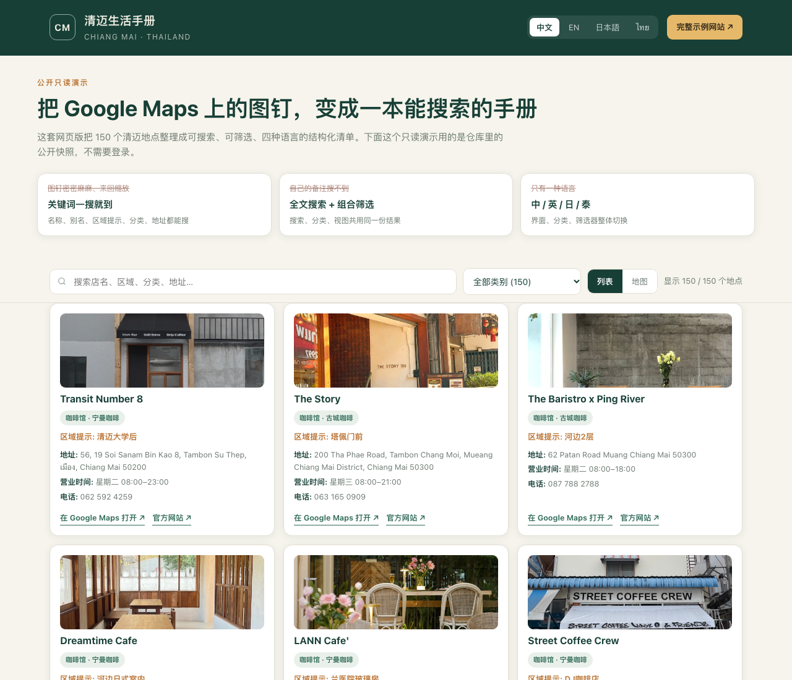
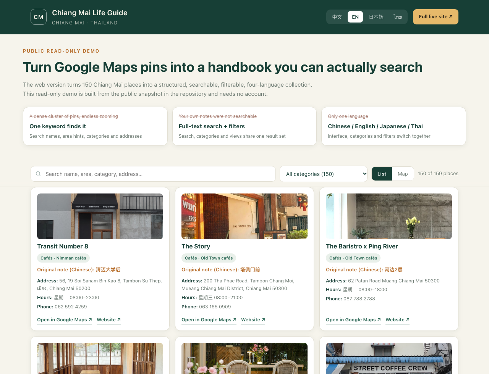
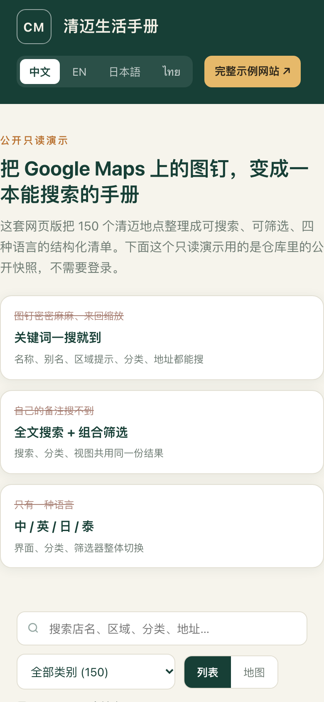

# Manual · คู่มือชีวิตเชียงใหม่ (清迈生活手册)

[English](../README.md) · [简体中文](README.zh-CN.md) · [日本語](README.ja.md) · [ไทย](README.th.md) · [เว็บไซต์ตัวอย่าง](https://cm.caishen.today) · [เดโมสาธารณะ](https://zixiang2008.github.io/favoriteManual/demo/)

> สรุปสั้น ๆ: เปลี่ยนสถานที่ 150 แห่งในเชียงใหม่ที่กระจัดกระจายอยู่ในหมุด Google Maps และสมุดโน้ต ให้กลายเป็น **เว็บคู่มือที่ค้นหาได้ กรองได้ รองรับ 4 ภาษา และออกแบบสำหรับมือถือ**

---

## สารบัญ

1. [โปรเจกต์นี้คืออะไร](#1-โปรเจกต์นี้คืออะไร)
2. [จุดเริ่มต้น: วิธีเดิมที่ใช้กัน](#2-จุดเริ่มต้น-วิธีเดิมที่ใช้กัน)
3. [ปัญหาที่ต้องการแก้](#3-ปัญหาที่ต้องการแก้)
4. [เว็บเวอร์ชันแก้ปัญหาอย่างไร](#4-เว็บเวอร์ชันแก้ปัญหาอย่างไร)
5. [เปรียบเทียบ: เว็บเวอร์ชัน vs หมุด Google Maps เดิม](#5-เปรียบเทียบ-เว็บเวอร์ชัน-vs-หมุด-google-maps-เดิม)
6. [ข้อดีเมื่อเทียบกับ Google Maps](#6-ข้อดีเมื่อเทียบกับ-google-maps)
7. [คุณค่าเพิ่มเติมที่ได้](#7-คุณค่าเพิ่มเติมที่ได้)
8. [ตัวอย่างออนไลน์](#8-ตัวอย่างออนไลน์)
9. [รายการความสามารถ](#9-รายการความสามารถ)
10. [สถาปัตยกรรม](#10-สถาปัตยกรรม)
11. [เริ่มใช้งานและการตั้งค่า](#11-เริ่มใช้งานและการตั้งค่า)
12. [ความปลอดภัยและความเป็นส่วนตัว](#12-ความปลอดภัยและความเป็นส่วนตัว)
13. [กรณีใช้งานและการขยายต่อ](#13-กรณีใช้งานและการขยายต่อ)
14. [ข้อควรระวังในการนำไปใช้](#14-ข้อควรระวังในการนำไปใช้)

---

## 1. โปรเจกต์นี้คืออะไร

Manual (คู่มือชีวิตเชียงใหม่ / 清迈生活手册) คือ **PWA (Progressive Web App) ที่ออกแบบสำหรับมือถือเป็นอันดับแรก** สำหรับจัดการรายการสถานที่ในเชียงใหม่ที่เก็บสะสมไว้ส่วนตัว ได้แก่ คาเฟ่ ร้านอาหาร ตลาด บ่อน้ำร้อน ฟิตเนส บาร์ สถานที่จัดกิจกรรม ร้านแลกเงิน ร้านซ่อมรถจักรยานยนต์ และติดต่อฉุกเฉิน เป็นต้น

โปรเจกต์นี้แทนที่วิธีเดิมคือ "ปักหมุดใน Google Maps + จดโน้ตใน Notion" ด้วยเว็บไซต์ของตัวเอง:

- สถานที่ 150 แห่ง ใน 26 หมวดหมู่ ค้นหา กรอง และเรียกดูได้ในเบราว์เซอร์โดยตรง
- สลับภาษาได้ทันทีระหว่าง จีน อังกฤษ ญี่ปุ่น และไทย
- มุมมองแบบรายการ และมุมมองลูกโลก/แผนที่แบบโต้ตอบ
- กรองตามหมวดหมู่ และกรองระยะใกล้ตั้งแต่ 200 เมตรถึง 10 กิโลเมตร
- ข้อมูลจาก Google Maps (ที่อยู่ เวลาเปิดทำการ โทรศัพท์ เว็บไซต์ รูปภาพ) ถูกรวมไว้ในบัตรสถานที่แต่ละแห่ง
- เพื่อนสามารถเสนอสถานที่ใหม่ ให้ดาว และผู้ดูแลกับผู้ดูแลร่วมแก้ไขข้อมูลออนไลน์ได้
- เข้าถึงแบบส่วนตัวด้วย PIN 4 หลักและรหัสเชิญที่จำกัดจำนวนครั้ง **ไม่มีข้อมูลเข้าสู่ระบบใด ๆ อยู่ในรีโพซิทอรีหรือหน้าเดโม**

**เว็บไซต์ตัวอย่าง: <https://cm.caishen.today>** (ต้องมีบัญชี)
**เดโมสาธารณะแบบอ่านอย่างเดียว: <https://zixiang2008.github.io/favoriteManual/demo/>** (ไม่ต้องมีบัญชี ลองค้นหา กรองหมวดหมู่ และสลับ 4 ภาษาได้ทันที)

---

## 2. จุดเริ่มต้น: วิธีเดิมที่ใช้กัน

เดิมรายการนี้ถูกดูแลแบบนี้:

1. ให้ดาวหรือปักหมุดสถานที่ใน Google Maps ทั้งที่อยากไป ที่เคยไป และที่อยากกลับไปอีก
2. พร้อมกันนั้นจดโน้ตใน Notion ด้วยข้อความที่เข้าใจได้เฉพาะเจ้าของ เช่น "ปิด 5 ทุ่ม" "หลังมอเชียงใหม่" "ในสวนมีตู้รถไฟ" "เหมาะดูพระอาทิตย์ตก"
3. แปะลิงก์สั้น `maps.app.goo.gl` ไว้ในแต่ละโน้ต เพื่อกระโดดจากสมุดโน้ตกลับไปที่แผนที่

ผลคือ **สถานที่อยู่ในแผนที่ คำอธิบายอยู่ในสมุดโน้ต และมีเพียงลิงก์สั้น ๆ ที่เชื่อมทั้งสองเข้าด้วยกัน** เมื่อหมุดสะสมเกินร้อยแห่ง วิธีนี้ก็ใช้ไม่ได้อีกต่อไป

---

## 3. ปัญหาที่ต้องการแก้

### 3.1 หมุดที่บันทึกไว้ใน Google Maps หายากมาก และไม่สื่อความหมายในภาพรวม

- เปิดแผนที่ขึ้นมาก็เจอหมุดแน่นไปหมด จะหา "คาเฟ่ริมแม่น้ำที่เคยไปเมื่อก่อน" ต้องซูมเข้า ซูมออก เลื่อนไปมา แล้วแตะหมุดทีละอันเทียบกับความจำ
- ไม่มีภาพรวม: มองไม่เห็นว่า **มีทั้งหมดกี่แห่ง แบ่งเป็นหมวดหมู่อะไรบ้าง แต่ละหมวดมีกี่แห่ง และกระจุกอยู่ย่านไหน** ยิ่งสะสมมาก ยิ่งดูเหมือนจุดกระจัดกระจายมากกว่าคู่มือเล่มหนึ่ง
- หมุดบอกแค่ว่า "อยู่ที่ไหน" ไม่ได้บอกว่า "ทำไมถึงบันทึกไว้" โน้ต คำใบ้ย่าน และหมวดหมู่ย่อยอยู่ในแอปอื่น
- ลำดับในรายการที่บันทึกไว้เป็นไปตามแพลตฟอร์ม ไม่ใช่ตามวิธีคิดของเจ้าของ จึงไม่สามารถเรียกดูตามหมวดที่ตั้งเอง เช่น "จุดชมพระอาทิตย์ตก" "ขับรถหนึ่งชั่วโมง" "แถวนิมมาน" ได้

### 3.2 ไม่มีฟังก์ชันค้นหา

- Google Maps ค้นหาสถานที่ทั่วโลกได้แน่นอน แต่ **ค้นหาสิ่งที่เราเขียนเกี่ยวกับสถานที่ที่เราบันทึกไว้เองไม่ได้** ทั้งโน้ตที่เขียนเอง คำใบ้ย่าน แท็ก หมวดหมู่ย่อย และชื่อโน้ตต้นฉบับ
- จึงเกิดอาการ "รู้ว่าเคยจดไว้ แต่หาไม่เจอ" ต้องกวาดสายตาผ่านหมุดหรือรายการยาว ๆ หรือค้นหาแยกใน Notion แล้วค่อยกระโดดกลับไปที่แผนที่
- ไม่มีการกรองแบบผสม "หมวดหมู่ + คำค้น + ระยะทาง" และไม่สามารถตอบคำถามว่า "ตอนนี้มีคาเฟ่ในระยะ 500 เมตรบ้างไหม"

### 3.3 มีภาษาเดียว แต่ผู้ใช้ต้องการหลายภาษา

- ภาษาของหน้าจอตามการตั้งค่าเครื่อง ชื่อสถานที่มักเป็นภาษาไทยหรืออังกฤษ ส่วน **โน้ตและหมวดหมู่ที่เขียนเองเป็นภาษาจีนทั้งหมด** จึงมี 3 ภาษาปนกันในรายการเดียว โดยไม่มีรูปแบบการแสดงผลที่สอดคล้องกัน
- เพื่อน คนพำนัก และผู้มาเยือนในเชียงใหม่มาจากบริบทภาษาจีน อังกฤษ ญี่ปุ่น และไทย การส่งรายการที่จดโน้ตภาษาจีนให้เพื่อนญี่ปุ่นหรือคนไทย แทบใช้ประโยชน์ไม่ได้
- ชื่อหมวดหมู่ เช่น "ของอร่อยซ่อนอยู่" "ในซอย" "ทริปหนึ่งชั่วโมง" เป็นภาษาจีนที่เป็นส่วนตัวสูง สลับเป็นภาษาของผู้อ่านไม่ได้ และไม่มีกลไกแปลทีละรายการ
- สิ่งที่ขาดไม่ใช่ "แปลชื่อสถานที่หนึ่งแห่ง" แต่คือ **ความสามารถให้คู่มือทั้งเล่มสลับภาษาตามผู้อ่าน**

### 3.4 โน้ตกับแผนที่แยกกัน และค่าดูแลเพิ่มขึ้นเรื่อย ๆ

- ทุกสถานที่ต้องดูแลสองที่ คือหมุดในแผนที่และข้อความในสมุดโน้ต เปลี่ยนชื่อร้านหรือเวลาเปิดทำการต้องแก้ทั้งสองฝั่ง และลิงก์สั้นที่เสียก็แทบไม่มีทางสังเกต
- ลิงก์สั้นเมื่อเวลาผ่านไปจะตรวจไม่ได้ว่าชี้ไปที่ไหน ระหว่างการจัดระเบียบข้อมูลของโปรเจกต์นี้ก็พบทั้งรายการที่ "เดิมไม่มีลิงก์แผนที่" และ "ลิงก์ไม่ได้ชี้ไปยังสถานที่เดี่ยวอีกต่อไป" ซึ่งต้องแก้ทีละรายการ
- ไม่มีโครงสร้างข้อมูล ที่อยู่ โทรศัพท์ เวลาเปิดทำการ และรูปภาพพิมพ์ด้วยมือ ตรวจสอบทีต้องสลับหลายแอป

### 3.5 การแชร์และดูแลร่วมกันมีขีดจำกัด

- รายการใน Google Maps แชร์ได้ แต่โดยพื้นฐานคือ "ให้คนอื่นเห็นหมุด" เพื่อนไม่สามารถเพิ่มสถานที่ใหม่ แก้ข้อมูล หรือแนบรูปได้ง่าย ๆ และไม่มีทั้งบันทึกว่าใครมีส่วนร่วมอะไรและแรงจูงใจ
- เมื่อหลายคนแก้พร้อมกัน สมุดโน้ตกับแผนที่จะคลาดเคลื่อนกัน โดยไม่มีการป้องกันการเขียนทับและไม่มีประวัติการดำเนินการ

### 3.6 บนมือถือไม่มีประสบการณ์แบบ "คู่มือ"

- แอปแผนที่สร้างมาเพื่อนำทาง ไม่ใช่เพื่อพลิกดูคู่มือสะสมของตัวเอง ติดตั้งบนหน้าจอหลักไม่ได้ อ่านออฟไลน์ไม่ได้ ไม่มีการจัดการ์ดสำหรับอ่านบนมือถือ และยิ่งใช้งานยากเมื่อสัญญาณอ่อน
- การตอบคำถามง่าย ๆ ในชีวิตประจำวันว่า "วันนี้ไปไหนดี" ต้องใช้ขั้นตอนยาวเกินไป

### 3.7 ข้อมูลไม่ได้อยู่ในมือเรา

- โครงสร้างของรายการถูกกำหนดโดยแพลตฟอร์ม การปรับ UI เปลี่ยนรูปแบบรายการ ข้อจำกัดของบัญชีหรือภูมิภาค อาจทำให้หมุดที่สะสมมาหลายปีส่งออกหรือนำกลับมาใช้ได้ยาก
- โน้ตส่วนตัวก็ไม่เหมาะจะเปิดเผยทั้งหมด แต่แพลตฟอร์มไม่มีการควบคุมการเข้าถึงแบบ "วงจำกัด เพิกถอนได้ ตรวจสอบได้"

---

## 4. เว็บเวอร์ชันแก้ปัญหาอย่างไร

แนวคิดไม่ใช่ "สร้างแผนที่อีกอัน" แต่คือ **แปลงรายการสะสมให้เป็นข้อมูลมีโครงสร้างที่ค้นหาได้ แล้วนำเสนอผ่านเว็บ**:

| ขั้นตอน | สิ่งที่ทำ |
|---|---|
| เก็บข้อมูล | Notion ยังเป็นช่องทางป้อนข้อมูลเพียงช่องทางเดียว คงนิสัยจดโน้ตอิสระไว้ |
| จัดโครงสร้าง | ซิงก์ทางเดียวตามเวลา แยกโน้ตเป็นฟิลด์: ชื่อ คำใบ้ย่าน หมวดหมู่ หมวดหมู่ย่อย แท็ก พิกัด ลิงก์แผนที่ |
| เติมข้อมูล | แคช Google Maps เติมที่อยู่ โทรศัพท์ เวลาเปิดทำการ เว็บไซต์ รูปภาพ และลิงก์สถานที่จริง |
| นำเสนอ | บริการ Node.js รวมข้อมูลตอนมีคำขอ แล้วส่งมอบ PWA สำหรับมือถือที่มีช่องค้นหา ตัวกรอง มุมมองรายการ/ลูกโลก และ 4 ภาษา |
| ดูแลร่วมกัน | ผู้ใช้ที่ล็อกอินเสนอสถานที่ ให้ดาว ผู้ดูแลแก้ชั้นแสดงผล และสถานะของชุมชนถูกเก็บแยกต่างหาก ไม่ถูกซิงก์ทับ |

จุดออกแบบสำคัญ: **เว็บไซต์ไม่เขียนกลับไปยัง Notion** Notion คือคลังต้นฉบับ `runtime/` คือชั้นสถานะของชุมชน และการแก้ของผู้ดูแลมีผลเฉพาะชั้นแสดงผล ดังนั้นการซิงก์ครั้งถัดไปจะไม่ลบสิ่งที่ทุกคนร่วมกันเพิ่มไว้

---

## 5. เปรียบเทียบ: เว็บเวอร์ชัน vs หมุด Google Maps เดิม

| มิติ | เดิม: หมุด Google Maps + สมุดโน้ต | ตอนนี้: เว็บคู่มือ |
|---|---|---|
| หาสถานที่หนึ่งแห่ง | ซูม เลื่อน แตะหมุดทีละอัน เทียบกับความจำ | พิมพ์คำค้นแล้วกรองทันที ตรงกับชื่อ ชื่อเรียก คำใบ้ย่าน หมวดหมู่ แท็ก โน้ต และที่อยู่ |
| ภาพรวม | กลุ่มจุดที่มองไม่เห็นขนาดและโครงสร้าง | ขึ้นต้นด้วย "150 แห่ง / 26 หมวดหมู่" พร้อมปุ่มหมวดหมู่และการ์ดที่อ่านง่าย |
| ค้นหา | ค้นหาได้เฉพาะสถานที่ของแพลตฟอร์ม ไม่ใช่โน้ตและป้ายกำกับของเรา | ค้นหาเต็มข้อความ + กรองผสมหมวดหมู่ ระยะทาง และคำค้น |
| ภาษา | หน้าจอตามเครื่อง โน้ตกับหมวดหมู่มีภาษาเดียว | UI จีน/อังกฤษ/ญี่ปุ่น/ไทย พร้อมแผนที่หมวดหมู่และป้ายกำกับ สลับแตะเดียว |
| ความหนาแน่นของข้อมูล | หมุดบอกแค่ตำแหน่ง คำอธิบายอยู่แอปอื่น | การ์ดเดียวมีทั้งโน้ต หมวดหมู่ ที่อยู่ เวลาทำการ โทรศัพท์ รูปภาพ และลิงก์แผนที่ |
| มุมมอง | มีแค่แผนที่ | รายการ + ลูกโลก/แผนที่โต้ตอบ สลับโดยไม่เสียเงื่อนไขกรอง |
| ใกล้ ๆ | กะด้วยสายตา | กรองระยะชัดเจน 200 เมตรถึง 10 กิโลเมตร |
| ดูแลร่วมกัน | รายการที่แชร์อ่านได้เป็นหลัก | เสนอสถานที่ ให้ดาว ผู้ดูแลร่วม แก้ออนไลน์ บันทึกตรวจสอบ |
| มือถือ | แอปนำทาง ไม่มีออฟไลน์ ไม่มีไอคอนหน้าจอหลัก | ติดตั้งเป็น PWA ได้ แคชด้วย Service Worker จัดวางแบบมือถือก่อน |
| ความเป็นเจ้าของข้อมูล | โครงสร้างของแพลตฟอร์ม ส่งออกยาก | มีสแนปชอต `data/` ของตัวเอง + สคริปต์สร้างซ้ำได้ ย้ายและสำรองได้อิสระ |
| ควบคุมการเข้าถึง | เปิดเผยหรือแชร์ลิงก์ | ล็อกอิน PIN รหัสเชิญจำกัดครั้งและเพิกถอนได้ เซสชันลงนาม จำกัดความถี่ บันทึกตรวจสอบ |
| การพึ่งพา | ผูกกับแพลตฟอร์มทั้งหมด | ถือข้อมูลเอง Google Maps เป็นเพียงตัวเติมข้อมูล ไม่ใช่ทางเข้าหนึ่งเดียว |

---

## 6. ข้อดีเมื่อเทียบกับ Google Maps

1. **จาก "ตามหาหมุด" เป็น "ค้นหาเนื้อหา"** การค้นหาครอบคลุมทุกสิ่งที่เราเขียนเอง ไม่ใช่แค่ชื่อร้านที่แพลตฟอร์มจัดทำดัชนีไว้ ความรู้ที่เคยจดไว้กลับมาใช้ได้อีกครั้ง นี่คือการปรับปรุงที่ตรงจุดที่สุด
2. **จาก "จุดกระจัดกระจาย" เป็น "คู่มือที่มีสารบัญ"** หมวดหมู่ แท็ก คำใบ้ย่าน และหมวดหมู่ย่อยกลายเป็นสารบัญ เรียกดูตามความตั้งใจแล้วค่อยตัดสินใจไปที่ไหน
3. **4 ภาษาที่ใช้งานได้จริง** ไม่ใช่แค่แปลเมนู แต่หน้าจอ หมวดหมู่ ตัวกรอง และคำใบ้สลับพร้อมกัน ข้อมูลชุดเดียวจึงส่งให้ผู้อ่านต่างภาษาได้
4. **ข้อมูลรวมอยู่ที่เดียว** ที่อยู่ เวลาทำการ โทรศัพท์ เว็บไซต์ รูปภาพ และลิงก์แผนที่อยู่ในการ์ดเดียว ไม่ต้องสลับไปมาระหว่างแผนที่ สมุดโน้ต และผลค้นหา
5. **สองมุมมองที่เติมกัน** รายการเหมาะกับ "พลิกดูคู่มือ" แผนที่เหมาะกับ "ดูการกระจายเชิงพื้นที่" ทั้งคู่ใช้ผลกรองชุดเดียวกัน
6. **ระยะทางเป็นตัวกรอง ไม่ใช่การกะคาด** 200 เมตรถึง 10 กิโลเมตร ตอบว่า "ตอนนี้แถวนี้มีอะไร" ไม่ใช่แค่ "แผนที่มีอะไร"
7. **ออกแบบตามการใช้งานของตัวเองได้** กำหนดระบบหมวดหมู่ รูปแบบโน้ต และชื่อแสดงผลเองได้ ไม่ถูกจำกัดด้วยรายการรูปแบบตายตัวของแพลตฟอร์ม
8. **ดูแลร่วมกันและตรวจสอบย้อนหลังได้** เพื่อนเสนอสถานที่ ระบบดาวกระตุ้นการมีส่วนร่วม เลื่อนเป็นผู้ดูแลร่วมอัตโนมัติ แก้ชั้นแสดงผล และมีบันทึกตรวจสอบ โดยซิงก์ไม่เขียนทับสิ่งที่ชุมชนเพิ่มไว้
9. **เป็นส่วนตัวแต่แชร์ได้** PIN และรหัสเชิญจำกัดครั้งควบคุมผู้เข้าถึงได้ เหมาะกับรายการส่วนตัวมากกว่าลิงก์สาธารณะ
10. **มือถือก่อน และใช้ออฟไลน์ได้** ติดตั้งเป็น PWA ได้ แคชทรัพยากรคงที่ จึงเปิดอ่านได้แม้สัญญาณอ่อน
11. **ข้อมูลเป็นของเรา ย้ายได้เสมอ** JSON มีโครงสร้าง พร้อมสคริปต์ซิงก์และสร้างข้อมูล ทำให้สร้างใหม่ ส่งออก และสำรองได้ทุกเมื่อ
12. **ยังคงเป็นแค่หน้าเว็บ** เปิดด้วยลิงก์เดียว ไม่ต้องติดตั้งแอป ไม่ต้องผ่านสโตร์ ประสบการณ์เหมือนกันบน iPhone Android และเดสก์ท็อป

---

## 7. คุณค่าเพิ่มเติมที่ได้

- **เก็บจุดเด่นของ Google Maps ไว้ เติมเฉพาะส่วนที่ขาด** โปรเจกต์ไม่ได้ทิ้ง Google Maps ที่อยู่ เวลาทำการ โทรศัพท์ เว็บไซต์ รูปภาพ และลิงก์สถานที่ยังมาจากแคช Google Maps และการ์ดทุกใบยังมีลิงก์กลับไปนำทางได้ เว็บเวอร์ชันคือ "ชั้นจัดระเบียบและค้นหาที่ใช้ง่ายขึ้น" ไม่ใช่ตัวแทนที่เข้ามาแทนที่
- **จัดครั้งเดียว ใช้ประโยชน์ยาว** Notion ยังเป็นช่องทางป้อนข้อมูลที่ต้นทุนต่ำ เว็บรับหน้าที่จัดโครงสร้าง ซิงก์เป็นทางเดียว แทนที่แบบอะตอมมิก และเก็บเวอร์ชันเดิมเมื่อล้มเหลว จึงไม่ทำให้ไซต์พังตอนอัปเดตเนื้อหา
- **คุณภาพเนื้อหามองเห็นได้** ขั้นตอนดึงข้อมูลจะทำเครื่องหมายรายการที่ "ยืนยันตรงกับสถานที่จริงใน Google" และรายการที่ "ลิงก์ใช้ไม่ได้" ข้อมูลเสียจึงไม่หลุดเข้ามาในคู่มือแบบเงียบ ๆ
- **ชุมชนดูแลตัวเองได้** ได้ 5 ดาวต่อสถานที่ใหม่ และเลื่อนเป็นผู้ดูแลร่วมอัตโนมัติที่ 30 ดาว เปลี่ยนคำถามว่า "ใครจะดูแล" ให้เป็นกลไก แทนการพึ่งคนคนเดียว
- **นำไปใช้กับเมืองหรือธีมไหนก็ได้** ข้อมูล ระบบหมวดหมู่ และพจนานุกรมภาษาเป็นเพียงค่าตั้งค่า เปลี่ยน `places.json` ก็กลายเป็นคู่มือกรุงเทพฯ รายการคาเฟ่โตเกียว ชุดเส้นทางเดินป่า หรือคลังทรัพยากรภายในทีม
- **ไม่มีโฆษณา ไม่มีตัวติดตามจากบุคคลที่สาม** โฮสต์เอง ไม่มีโฆษณาหรือคำแนะนำจากแพลตฟอร์มแทรกในหน้าจอ
- **ติดตั้งไม่ซับซ้อน** บริการ Node.js ตัวเดียว + Docker + Cloudflare Tunnel ต้นทางรับฟังเฉพาะ loopback ไม่ต้องเปิดพอร์ตสู่สาธารณะ และ HTTPS ถูกจัดการที่ขอบเครือข่าย

---

## 8. ตัวอย่างออนไลน์

| จุดประสงค์ | URL | หมายเหตุ |
|---|---|---|
| เว็บไซต์ตัวอย่างฉบับเต็ม | **<https://cm.caishen.today>** | เวอร์ชันใช้งานจริง มีล็อกอิน การเสนอสถานที่ มุมมองลูกโลก และกรองระยะใกล้ ต้องมีบัญชี |
| URL เดิม | <https://cm.caishen2049.us> | แอปและข้อมูลชุดเดียวกัน เก็บไว้เพื่อลิงก์ที่แชร์ไปก่อนหน้า |
| เดโมสาธารณะแบบอ่านอย่างเดียว | <https://zixiang2008.github.io/favoriteManual/demo/> | ไม่ต้องมีบัญชี ลองค้นหาเต็มข้อความ กรองหมวดหมู่ สลับ 4 ภาษา และดูการ์ดสถานที่ สร้างจากสแนปชอตสาธารณะในรีโพซิทอรีนี้ |

**ตัวอย่างหน้าจอ** (เดโมสาธารณะแบบอ่านอย่างเดียว):

<p>


</p>
<p></p>

> รูปสถานที่ในภาพหน้าจอมาจากแคชสาธารณะของ Google Maps และใช้เพื่อสาธิตหน้าจอเท่านั้น

เดโมเป็นเวอร์ชันคงที่แบบอ่านอย่างเดียว เพื่อแสดงว่า "ทำไมเว็บเวอร์ชันถึงหาง่ายและอ่านง่ายกว่า" ส่วนล็อกอิน การเสนอสถานที่ ตัวกรองระยะทาง และลูกโลกแบบโต้ตอบ อยู่ในเว็บไซต์ตัวอย่างฉบับเต็ม **เพื่อความเป็นส่วนตัว ทั้งรีโพซิทอรีและเดโมไม่มี PIN รหัสเชิญ หรือข้อมูลเข้าสู่ระบบใด ๆ**

ข้อมูลเดโมสร้างใหม่ได้ด้วย `node scripts/build-demo-data.mjs` จาก `data/places.json` และ `data/google-maps-cache.json`

---

## 9. รายการความสามารถ

- PWA มือถือ 4 ภาษา: จีน อังกฤษ ญี่ปุ่น ไทย
- ค้นหาเต็มข้อความ กรองหมวดหมู่ หมวดหมู่ย่อย แท็ก และระยะ 200 เมตรถึง 10 กิโลเมตร
- มุมมองรายการ และมุมมองลูกโลก/แผนที่แบบโต้ตอบ (MapLibre + ไทล์ OpenStreetMap)
- สแนปชอต 150 แห่งใน 26 หมวดหมู่ พร้อมที่อยู่ เวลาทำการ โทรศัพท์ เว็บไซต์ การจอง รูปภาพ และลิงก์แผนที่
- ผู้ใช้ระบุชื่อ PIN 4 หลัก scrypt hash ใส่ salt เซสชันลงนาม จำกัดความถี่ล็อกอิน บันทึกตรวจสอบ
- รหัสเชิญจำกัดจำนวนครั้งและเพิกถอนได้
- ซิงก์ทางเดียวจาก Notion ตามเวลา แทนที่แบบอะตอมมิก เก็บเวอร์ชันเดิมเมื่อล้มเหลว
- เสนอสถานที่จากชุมชน เลือกแสดงชื่อผู้เสนอได้ บีบอัดรูปภาพฝั่งไคลเอนต์
- 5 ดาวต่อสถานที่ใหม่ เลื่อนเป็นผู้ดูแลร่วมอัตโนมัติที่ 30 ดาว
- ผู้ดูแลและผู้ดูแลร่วมแก้ไขผ่านชั้น override การแสดงผลที่คงทน
- ติดตั้งด้วย Docker หลัง Cloudflare Tunnel โดยไม่เปิดเผยต้นทาง

---

## 10. สถาปัตยกรรม

```text
Notion workspace (ช่องทางป้อนข้อมูล)
  | ซิงก์ทางเดียวตามเวลา แทนที่แบบอะตอมมิก
  v
data/places.json + แคช Google Maps (สแนปชอตเปิดเผยได้)
  | รวมข้อมูลตอนมีคำขอ
  v
บริการ Node.js
  + ผู้ใช้ รหัสเชิญ เซสชัน บันทึกตรวจสอบ
  + การเสนอสถานที่และสื่อจากชุมชน
  + ชั้น override การแสดงผลของผู้ดูแล (runtime/)
  v
PWA มือถือ: ค้นหา / หมวดหมู่ / ระยะทาง / รายการ / ลูกโลก / 4 ภาษา
  v
Cloudflare Tunnel + HTTPS
```

`runtime/` เก็บผู้ใช้ การเสนอสถานที่ รูปภาพ override การแสดงผล และบันทึกตรวจสอบ แยกจากกระบวนการซิงก์ จึงไม่ถูกลบเมื่อซิงก์ Notion และการแก้ของผู้ดูแลมีผลเฉพาะชั้นแสดงผล ไม่เขียนทับบันทึกต้นฉบับใน Notion

---

## 11. เริ่มใช้งานและการตั้งค่า

ต้องใช้ Node.js 22 ขึ้นไป

```bash
cp .env.example .env
npm install
npm start
```

เปิด `http://127.0.0.1:3000` สร้างแฮช PIN ด้วย `npm run hash-pin -- 1234` แล้วใส่เฉพาะแฮชลงใน `PIN_USERS_JSON`

| ตัวแปร | จุดประสงค์ |
|---|---|
| `SESSION_SECRET` | ลงนามเซสชันและเข้ารหัสรหัสเชิญ |
| `PIN_USERS_JSON` | บัญชีเริ่มต้น (เฉพาะแฮช) |
| `NOTION_TOKEN` | อ่านแหล่งข้อมูล Notion ที่แชร์ไว้ |
| `SYNC_INTERVAL_MINUTES` | ช่วงเวลาของการซิงก์ทางเดียว |
| `GOOGLE_MAPS_API_KEY` | สำรองเรียก Google Places สด แบบเลือกได้ |
| `RUNTIME_DIR` | ตำแหน่งเก็บถาวรของผู้ใช้ การแก้ไข สื่อ และบันทึกตรวจสอบ |

ซิงก์ ทดสอบ และคอนเทนเนอร์:

```bash
NOTION_TOKEN=your_token npm run sync:notion
npm test
docker compose up -d --build
curl http://127.0.0.1:3010/healthz
```

ในระบบจริงต้องเมานต์ `runtime/` แบบถาวรและใช้ HTTPS (คุกกี้เซสชันในระบบจริงบังคับ secure)

โครงสร้างไดเรกทอรี: `public/` ฟรอนต์เอนด์และหลายภาษา · `server.mjs` การยืนยันตัวตนและ API · `scripts/` ซิงก์และสร้างข้อมูล · `data/` สแนปชอตเปิดเผยได้ · `demo/` เดโมคงที่แบบอ่านอย่างเดียว · `test/` ทดสอบรวม · `ops/` ติดตั้งและตรวจสอบ

---

## 12. ความปลอดภัยและความเป็นส่วนตัว

- เก็บเฉพาะ scrypt hash ที่ใส่ salt ไม่เก็บ PIN เป็นข้อความธรรมดาเด็ดขาด
- จำกัดความถี่แบบทวีคูณเมื่อล็อกอินล้มเหลว
- คุกกี้ HttpOnly, SameSite และมีการลงนาม
- ตรวจสอบ origin สำหรับคำขอที่เปลี่ยนสถานะ
- บันทึกตรวจสอบการลงทะเบียน ล็อกอิน สิทธิ์ รหัสเชิญ และการแก้เนื้อหา
- `runtime/`, `.env`, ข้อมูลรับรองทันเนล และเอกสารปฏิบัติการ ถูกยกเว้นด้วย `.gitignore`

---

## 13. กรณีใช้งานและการขยายต่อ

เหมาะกับทุกสถานการณ์ที่มี "สถานที่จำนวนหนึ่ง + โน้ตส่วนตัวจำนวนมาก + ต้องเปิดหาซ้ำ ๆ" เช่น คู่มือใช้ชีวิตในเมือง เช็กลิสต์ย้ายที่อยู่ คอลเลกชันคาเฟ่และร้านอาหาร เส้นทางเดินป่าหรือปั่นจักรยาน การตรวจสอบหน้าร้าน คลังทรัพยากรของทีม และรายการสถานที่จัดกิจกรรม

ขยายต่อได้ตรงไปตรงมา: เปลี่ยนแหล่งข้อมูล ปรับระบบหมวดหมู่และพจนานุกรมภาษา เพิ่มฟิลด์หรือมุมมองตามต้องการ เพราะชั้นแสดงผลแยกจากคลังต้นฉบับ การเปลี่ยนหน้าจอจึงไม่ทำให้ข้อมูลต้นทางปนเปื้อน และหากไม่ต้องการการเข้าถึงแบบส่วนตัว ก็สามารถเผยแพร่เฉพาะรูปแบบเดโมคงที่เป็นไซต์สถิตได้เลย

---

## 14. ข้อควรระวังในการนำไปใช้

ก่อนนำไปใช้ซ้ำ โปรดตรวจสอบข้อกำหนดและใบอนุญาตล่าสุดของ Notion, Google Maps, รูปภาพจากบุคคลที่สาม และเนื้อหาที่นำเข้า เผยแพร่เฉพาะสื่อและข้อความที่คุณมีสิทธิ์ใช้ เว็บไซต์ตัวอย่างต้องใช้บัญชี โปรดอย่าพยายามเดาหรือขอข้อมูลรับรองการเข้าสู่ระบบ
