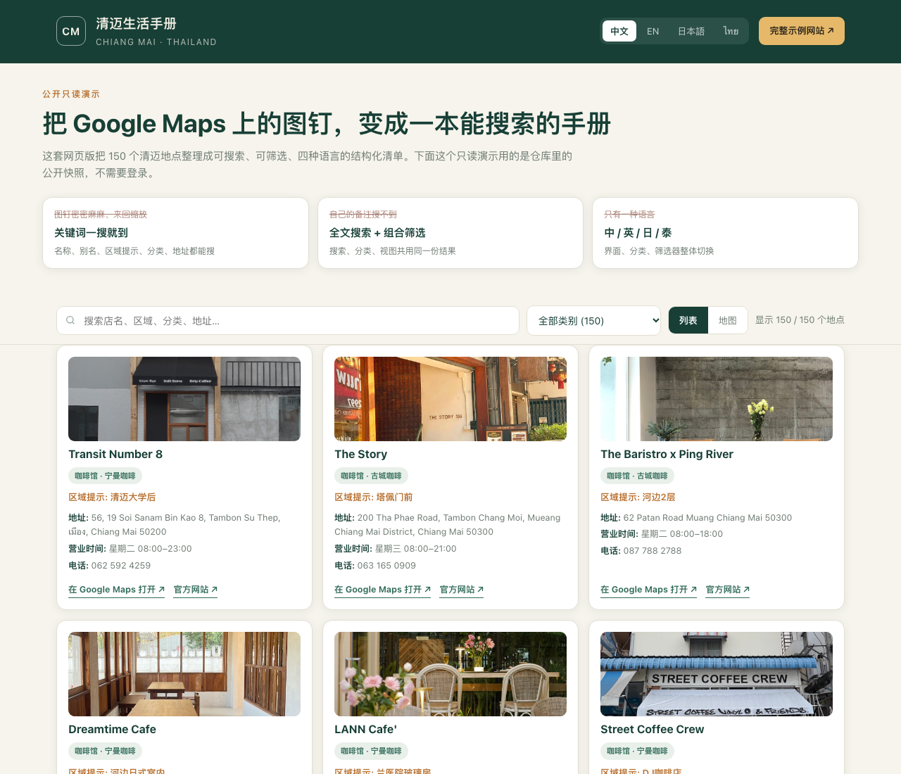
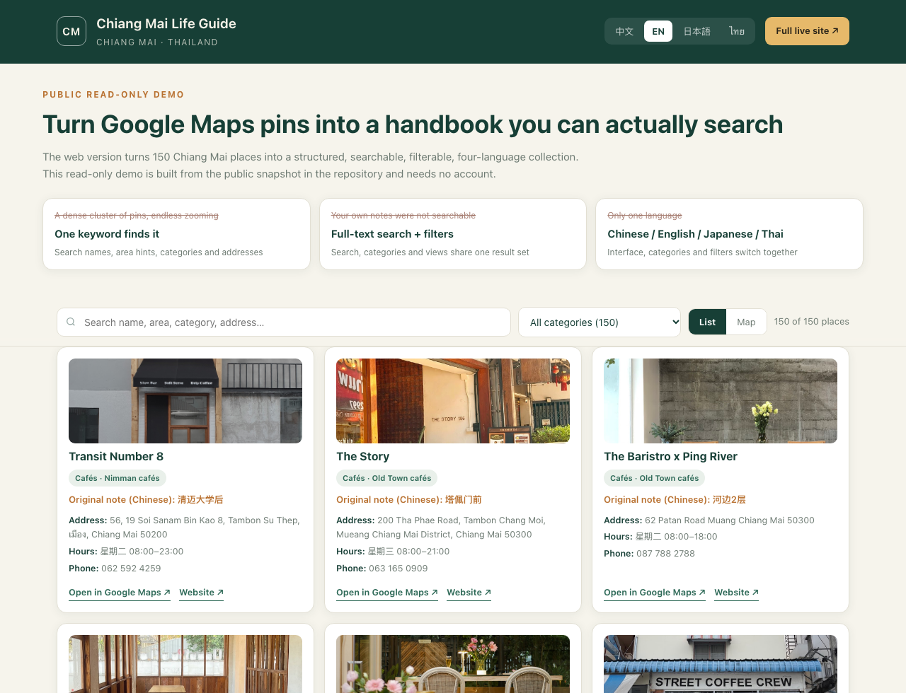
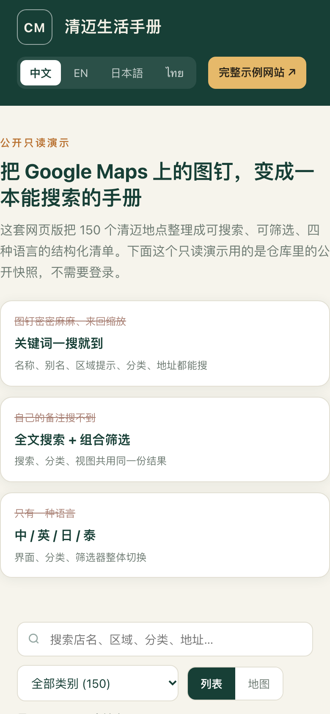

# Manual · 清迈生活手册

[English](../README.md) · [简体中文](README.zh-CN.md) · [日本語](README.ja.md) · [ไทย](README.th.md) · [示例网站](https://cm.caishen.today) · [在线只读演示](https://zixiang2008.github.io/favoriteManual/demo/)

> 一句话：把散落在 Google Maps 图钉和备忘录里的 150 个清迈地点，变成一个**可搜索、可筛选、四种语言、手机优先**的私人地点手册网站。

---

## 目录

1. [项目是什么](#1-项目是什么)
2. [它从哪里来：以前的工作方式](#2-它从哪里来以前的工作方式)
3. [要解决的痛点](#3-要解决的痛点)
4. [网页版如何解决](#4-网页版如何解决)
5. [网页版 vs 以前的 Google Maps 标记](#5-网页版-vs-以前的-google-maps-标记)
6. [相比 Google Maps 的具体优点](#6-相比-google-maps-的具体优点)
7. [带来的额外价值](#7-带来的额外价值)
8. [在线示例](#8-在线示例)
9. [功能一览](#9-功能一览)
10. [技术架构](#10-技术架构)
11. [快速开始与配置](#11-快速开始与配置)
12. [安全与隐私](#12-安全与隐私)
13. [适用场景与可扩展性](#13-适用场景与可扩展性)
14. [责任使用](#14-责任使用)

---

## 1. 项目是什么

Manual（清迈生活手册）是一个**手机优先的渐进式网页应用（PWA）**，用来管理一份私人整理的清迈生活地点清单——咖啡馆、餐厅、市集、温泉、健身房、酒吧、活动场地、换汇点、摩托维修、紧急联络等。

它把原来「在 Google Maps 上打图钉 + 在 Notion 里写备注」的工作方式，转换成一个独立的网站：

- 150 个地点、26 个分类，可在网页里直接搜索、筛选、浏览；
- 中文、英文、日文、泰文四种语言随时切换；
- 列表视图与交互式地图（地球/球体）视图双模式；
- 按类别、按距离（200 米到 10 公里）筛选附近地点；
- Google Maps 的地址、营业时间、电话、官网、照片等信息被合并进每个地点卡片；
- 朋友可以投稿新地点、给地点打星，管理员与联合管理员可以在线维护展示内容；
- 私有访问：4 位 PIN 登录、限次授权码注册，仓库与演示页都不含任何登录凭据。

**在线示例网站：<https://cm.caishen.today>**（需要账户）。**公开的只读演示：<https://zixiang2008.github.io/favoriteManual/demo/>**（无需账户，可体验搜索、分类与四语切换）。

---

## 2. 它从哪里来：以前的工作方式

最初的清单长这样：

1. 在 Google Maps 上把想去、去过、值得再去的地方一个个加星标、打图钉；
2. 同时在 Notion 里维护一份笔记，写下「这家几点关门」「在清迈大学后门」「园区里有火车车厢」「适合看落日」这类只有自己看得懂的备注；
3. 每条备注里贴一个 `maps.app.goo.gl` 短链接，用来从笔记跳回地图。

于是，**地点在地图里，说明在笔记里，两者靠一串短链接勉强连着**。时间一长，标记积累到上百个，这套办法就失效了。

---

## 3. 要解决的痛点

### 3.1 谷歌地图上标记的这些站点，查找起来非常麻烦，而且不够直观

- 打开地图看到的是一片密密麻麻的图钉。要找「上次那家在河边的咖啡馆」，只能反复缩放、拖动、逐个点开图钉辨认，靠记忆和图钉位置去猜。
- 没有整体视角：一眼看不出这批收藏**总共有多少、分成哪几类、每类多少、集中在哪几个区域**。清单越大，越像一堆散点而不是一本手册。
- 图钉只表达「在哪里」，不表达「为什么值得记」。备注、区域提示、细分类型都不在地图上，必须切回 Notion 才能看到。
- 收藏列表按添加顺序或平台排序，不是按自己的使用逻辑组织；想按「落日」「一小时车程」「宁曼附近」这类自己的分类浏览，做不到。

### 3.2 没有搜索功能

- Google Maps 当然能搜全世界，但它**搜不到你为自己这批收藏写下的内容**：自定义备注、区域提示、标签、细分分类、原笔记标题，都不在它的检索范围里。
- 结果就是「明明记过，却找不到」。只能靠肉眼在图钉或长列表里翻，或者在 Notion 里另开一次搜索，再手动跳回地图。
- 也没有「类别 + 关键词 + 距离」组合筛选，更没有「我附近 500 米内有哪些咖啡馆」这种基于当前位置的问答。

### 3.3 语言单一，满足不了多语言需求

- 界面语言跟随手机系统，地点名往往是泰文或英文，而**自己写的备注、分类、提示全是中文**——同一份清单里混着三套语言，没有统一呈现。
- 清迈的朋友、旅居者、访客来自中文、英语、日语、泰语四种语境。把一条中文备注的清单直接递给日本或泰国朋友，等于不可用。
- 分类名（例如「宝藏好喝」「巷子里」「一小时系列」）是高度个人化的中文表达，无法按接收者的语言切换，也没有任何逐条翻译机制。
- 换句话说：缺的不是「翻译一条地名」，而是**整份手册能按读者语言切换**的能力。

### 3.4 备注与地图割裂，维护成本越来越高

- 一个地点要维护两处：地图里的图钉、笔记里的文字。改了店名、换了营业时间，得两头改；短链接失效了也很难发现。
- 笔记里的地图链接经常是短链，时间久了无法判断指向哪里；本项目整理时就遇到「原始无地图链接」或「链接不再指向独立地点」的条目，需要逐条校正。
- 没有结构化字段：地址、电话、营业时间、照片全靠手写，查证一次要跳好几个应用。

### 3.5 分享与共同维护受限

- Google Maps 的清单可以共享，但基本停留在「别人能看到图钉」，很难让朋友补充新地点、修正信息、附上照片，也缺少「谁贡献了什么」的记录与激励。
- 一旦多人同时改，笔记和地图容易互相覆盖，没有版本保护，也没有操作留痕。

### 3.6 手机上没有「手册」的体验

- 地图应用是为导航设计的，不是为「翻阅一本自己的收藏册」设计的：不能安装到桌面、不支持离线查阅、没有针对手机阅读的卡片布局，网络不好时体验更差。
- 想快速回答「今天去哪里」这种日常问题时，操作流程太长。

### 3.7 数据不在自己手里

- 收藏结构由平台决定：界面改版、列表调整、账号或地区限制，都可能让多年积累的标记变得难以导出、难以复用。
- 私人备注也不适合完全公开，但平台缺少「小范围、可撤销、可审计」的访问控制。

---

## 4. 网页版如何解决

思路不是「再做一个地图」，而是**把收藏变成一份有结构的、可检索的数据，再用网页呈现**：

| 步骤 | 做法 |
|---|---|
| 收集 | Notion 继续作为唯一的录入端，保留原有的自由备注习惯 |
| 结构化 | 定时单向同步把笔记拆成字段：名称、区域提示、一级分类、细分类型、标签、坐标、地图链接 |
| 补全 | 用 Google Maps 缓存补齐地址、电话、营业时间、官网、照片、真实地点链接 |
| 呈现 | Node.js 服务在请求时合并数据，输出手机 PWA：搜索框、分类筛选、距离筛选、列表与地图双视图、四语界面 |
| 共建 | 用户登录后投稿地点、打星、管理员在线修正展示层，所有社区状态独立保存，不被同步覆盖 |

关键设计：**网站不反写 Notion**。Notion 是「原始档案」，`runtime/` 是「社区状态层」，管理员修改只作用于展示层，因此下一次同步不会抹掉大家的贡献。

---

## 5. 网页版 vs 以前的 Google Maps 标记

| 维度 | 以前：Google Maps 图钉 + 笔记 | 现在：清迈生活手册网页版 |
|---|---|---|
| 找某个地点 | 缩放、拖动、逐个点开图钉，靠记忆辨认 | 输入关键词即时过滤，命中名称、别名、区域提示、分类、标签、备注与地址 |
| 整体可读 | 一堆散点，看不出规模与结构 | 首屏即「150 个地点 / 26 个分类」，分类芯片、卡片列表一目了然 |
| 搜索 | 只能搜平台地点，搜不到自己的备注与自定义标签 | 全文搜索 + 分类、距离、关键词组合筛选 |
| 语言 | 界面随系统，备注与分类只有中文 | 中 / 英 / 日 / 泰四语界面，分类与标签按语言映射，一键切换 |
| 信息密度 | 图钉只有位置，说明在另一个应用里 | 一处卡片同时给出备注、分类、地址、营业时间、电话、照片与地图链接 |
| 视图 | 只有地图 | 列表 + 交互式地球/地图双视图，按需切换 |
| 附近 | 靠肉眼估算 | 200 米至 10 公里距离档位筛选 |
| 多人维护 | 共享清单基本只读 | 投稿、星级、联合管理员、在线编辑、审计留痕 |
| 手机体验 | 导航应用，无离线、无桌面图标 | PWA 可安装、Service Worker 缓存、移动优先排版 |
| 数据归属 | 平台结构，导出困难 | 自有 `data/` 快照 + 可复现脚本，随时迁移与备份 |
| 访问控制 | 公开或链接共享 | PIN 登录、限次可撤销授权码、签名会话、限流与审计 |
| 依赖 | 完全依赖平台 | 数据自持；Google Maps 只作为信息增强，不是唯一入口 |

---

## 6. 相比 Google Maps 的具体优点

1. **从「找图钉」变成「搜内容」**：搜索覆盖自己写下的所有文字，而不只是平台索引过的店名。记过的内容找得回来，这是最直接的改善。
2. **从「散点」变成「有目录的手册」**：分类、标签、区域提示、细分类型构成目录，先按类别浏览再决定去哪，决策路径短得多。
3. **四语真正可用**：不只是菜单翻译，界面、分类、筛选器、提示文案整体切换；同一份数据可以递给不同语言的朋友看。
4. **信息集中**：地址、营业时间、电话、官网、照片、地图链接合并到一张卡片，不再在地图、笔记、搜索结果之间来回跳。
5. **双视图互补**：列表适合「翻手册」，地图适合「看空间分布」，两者用同一份筛选结果，切换不丢上下文。
6. **距离是可筛选项**：200 米到 10 公里，回答「现在附近有什么」而不是「地图上哪里有什么」。
7. **可为自己的使用场景定制**：分类体系、备注格式、展示名称都由自己定，不受平台预设列表限制。
8. **可共建、可追溯**：朋友投稿、星级激励、联合管理员自动晋级，管理员修正展示层且留审计记录；同步不会覆盖社区贡献。
9. **私有但可分享**：用 PIN + 限次授权码控制谁能看，比「公开链接」更可控，也更适合私人清单。
10. **手机优先且可离线**：PWA 安装到桌面，Service Worker 缓存静态资源，弱网环境下仍能翻阅。
11. **数据自持、可迁移**：地点是结构化 JSON，配合同步与构建脚本可重新生成、导出、备份，避免被平台改版绑架。
12. **仍然是网页**：一个链接即可打开，无需安装 App、无需应用商店、跨 iPhone / Android / 桌面一致。

---

## 7. 带来的额外价值

- **保留 Google Maps 的长处，只补短板**：项目并没有抛弃 Google Maps——地址、营业时间、电话、官网、照片与地点链接仍由 Google Maps 缓存提供，卡片上一键跳回地图导航。网页版是「一层更好用的组织与检索」，而不是替代品。
- **一次整理，长期复利**：Notion 继续做低成本录入，网站负责结构化呈现；同步是单向、原子替换且失败保留上一版，内容更新不会把站点弄坏。
- **内容质量可见**：抓取阶段会标记「确认到真实 Google 地点」与「链接不可用」的条目，坏数据不会静默混进手册。
- **社区自运转**：每个新地点 5 颗星、累计 30 颗星自动成为联合管理员，把「谁来维护」变成机制而不是靠一个人。
- **可复用到任何城市或主题**：数据、分类、语言映射都是配置，换一份 `places.json` 就能变成曼谷手册、东京咖啡清单、徒步路线集或团队内部资源库。
- **无广告、无第三方追踪**：自托管服务，界面不插入平台广告与推荐，访问与内容都由自己掌握。
- **部署轻量**：Node.js 单服务 + Docker + Cloudflare Tunnel，源站只监听回环地址，不必暴露公网端口，HTTPS 由边缘提供。

---

## 8. 在线示例

| 用途 | 地址 | 说明 |
|---|---|---|
| 完整示例网站 | **<https://cm.caishen.today>** | 线上正式版本，含登录、投稿、地图视图与附近筛选；需要账户 |
| 兼容旧链接 | <https://cm.caishen2049.us> | 同一套应用与数据，保留给早期分享出去的链接 |
| 公开只读演示 | <https://zixiang2008.github.io/favoriteManual/demo/> | 无需账户，直接体验全文搜索、分类筛选、四语切换与地点卡片；数据来自本仓库的公开快照 |

**界面预览**（公开只读演示）：

<p>


</p>
<p></p>

> 截图中的地点照片来自 Google Maps 公开缓存，仅用于界面演示。

演示页是静态只读版本，用于说明「网页版为什么更好找、更好读」；登录、投稿、距离筛选与交互式地球视图请在完整示例网站中体验。**出于隐私考虑，仓库与演示页均不包含任何 PIN、授权码或登录凭据。**

演示数据可用 `node scripts/build-demo-data.mjs` 从 `data/places.json` 与 `data/google-maps-cache.json` 重新生成。

---

## 9. 功能一览

- 中文、英文、日文、泰文四语移动 PWA
- 全文搜索；一级分类、细分类型、标签与 200 米至 10 公里距离筛选
- 列表视图与交互式地球/地图视图（MapLibre + OpenStreetMap 瓦片）
- 150 个地点快照、26 个分类；地址、营业时间、电话、官网、预订、照片与地图链接
- 具名用户、4 位 PIN、加盐 scrypt 哈希、签名会话、登录限流、审计日志
- 可限次使用、可停用的注册授权码
- Notion 定时单向同步，原子替换，失败保留上一版
- 社区投稿、可选署名、客户端照片压缩
- 每个新地点 5 颗星，累计 30 颗星自动成为联合管理员
- 管理员与联合管理员通过持久化展示覆盖层在线编辑
- Docker 部署 + Cloudflare Tunnel，源站不暴露

---

## 10. 技术架构

```text
Notion 工作区（录入端）
  | 定时单向同步，原子替换
  v
data/places.json + Google Maps 缓存（可发布快照）
  | 请求时合并
  v
Node.js 服务
  + 用户、授权码、会话、审计
  + 社区投稿与媒体
  + 管理员展示覆盖层（runtime/）
  v
手机 PWA：搜索 / 分类 / 距离 / 列表 / 地图 / 四语
  v
Cloudflare Tunnel + HTTPS
```

`runtime/` 保存用户、投稿、照片、展示覆盖与审计记录，独立于同步流程，因此 Notion 同步不会删除社区内容；管理员修改只影响展示层，不改写 Notion 原始记录。

---

## 11. 快速开始与配置

需要 Node.js 22 或更新版本。

```bash
cp .env.example .env
npm install
npm start
```

打开 `http://127.0.0.1:3000`。用 `npm run hash-pin -- 1234` 生成 PIN 哈希，只把哈希写入 `PIN_USERS_JSON`。

| 变量 | 用途 |
|---|---|
| `SESSION_SECRET` | 会话签名与授权码加密 |
| `PIN_USERS_JSON` | 初始账户（仅存哈希） |
| `NOTION_TOKEN` | 读取共享 Notion 数据源 |
| `SYNC_INTERVAL_MINUTES` | 单向同步间隔 |
| `GOOGLE_MAPS_API_KEY` | 可选的实时 Google Places 兜底 |
| `RUNTIME_DIR` | 用户、编辑、媒体与审计的持久化目录 |

同步、测试与容器部署：

```bash
NOTION_TOKEN=your_token npm run sync:notion
npm test
docker compose up -d --build
curl http://127.0.0.1:3010/healthz
```

生产环境需持久化挂载 `runtime/` 并使用 HTTPS（生产会话 Cookie 为 secure-only）。

目录说明：`public/` 前端与多语言、`server.mjs` 认证与接口、`scripts/` 同步与数据构建、`data/` 可发布快照、`demo/` 静态只读演示、`test/` 集成测试、`ops/` 部署与巡检。

---

## 12. 安全与隐私

- PIN 只保存加盐 scrypt 哈希，绝不存明文
- 登录失败触发指数级限流
- HttpOnly、SameSite、签名 Cookie
- 状态变更请求校验来源
- 注册、登录、权限、授权码与内容编辑均写审计日志
- `runtime/`、`.env`、隧道凭据与运维文档均被 `.gitignore` 排除，不进仓库

---

## 13. 适用场景与可扩展性

适合任何「一批地点 + 一堆私人备注 + 需要反复查找」的场景：城市生活手册、旅居清单、咖啡/餐厅收藏、徒步与骑行路线、门店巡检、团队资源库、活动场地清单。

扩展方式很直接：替换数据源、调整分类映射与语言字典、按需增加字段或视图；展示层与原始档案分离，改界面不会污染原始数据。若不需要私有访问，也可以只保留静态演示形态，直接发布为纯静态站点。

---

## 14. 责任使用

复用前请自行核对 Notion、Google Maps、第三方照片与导入内容的最新条款与许可；只发布有权使用的媒体与文字。示例网站需要账户，请勿尝试猜测或索取凭据。
